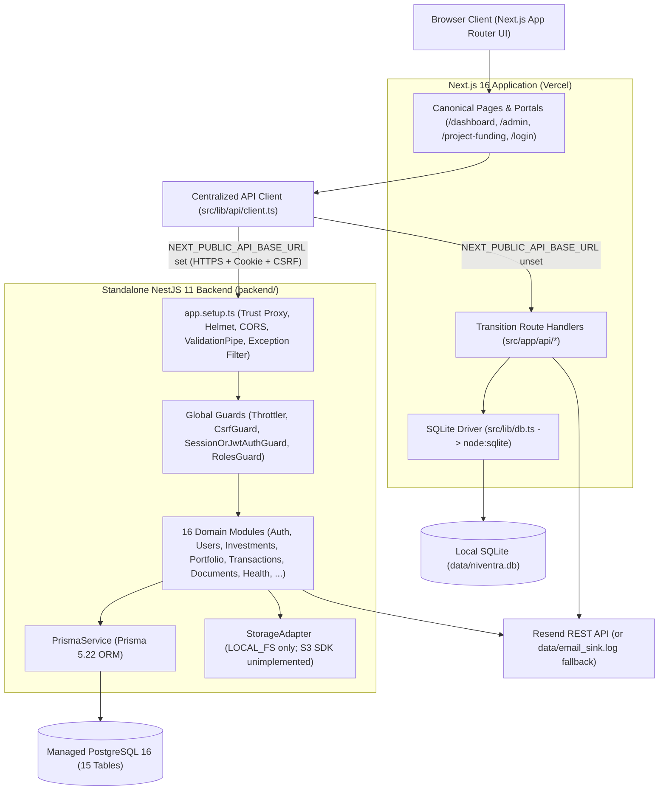
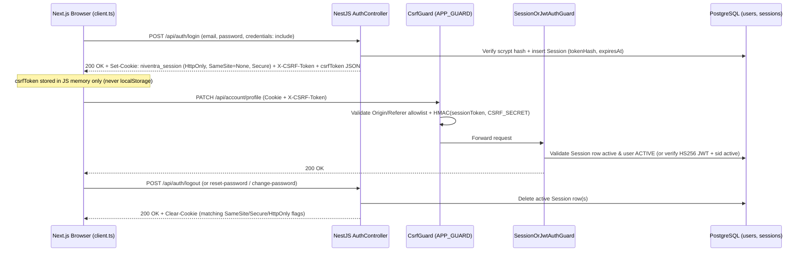

# Niventra Capital Advisory — System Architecture

**Updated:** November 12, 2026  
**Scope:** Documents the actual codebase architecture across the Next.js frontend, transition SQLite persistence, and standalone NestJS + Prisma PostgreSQL backend.

---

## 1. Dual-Mode Deployment Topology

The platform cleanly isolates UI rendering and client transport (`src/lib/api/client.ts`) from persistence:

- **Current / Transition Mode (`NEXT_PUBLIC_API_BASE_URL` unset):** Next.js (`src/app/`) serves pages and App Router handlers (`src/app/api/*`) backed by local SQLite (`data/niventra.db` via Node's native `node:sqlite`).
- **Decoupled Target Mode (`NEXT_PUBLIC_API_BASE_URL` set):** Next.js browser clients call the standalone NestJS REST API (`backend/`) directly with `credentials: "include"` and `X-CSRF-Token`, backed by Prisma ORM and PostgreSQL 16.

---

## 2. Split-Origin Authentication & CSRF Flow

Authentication supports both browser cookie sessions (`niventra_session`) and `Authorization: Bearer` tokens, both bound to persistent database `Session` rows via `sid`:

---

## 3. Backend Domain Boundaries (`backend/src/modules/`)

The NestJS application organizes business logic across **16 modules** (`AppModule`):

| Domain Module | Responsibility & Current Boundaries |
| :--- | :--- |
| `auth` | Register, login, logout, `GET /api/auth/me`, `GET /api/auth/csrf`, forgot/reset password (`PasswordResetToken`), scrypt + HS256/issuer/audience + `sid` revocation. |
| `users` | Profile, notification preferences, password change (revokes all sessions), DPDP account erasure requests (`/api/account/*` primary + `/api/users/*` legacy alias). |
| `project-funding` | Public developer application submission (`website_hp` honeypot, funding <= totalCost) + staff/admin filtering and status history updates. |
| `documents` | `APPROVED` status gating, non-`PUBLIC` role restrictions, owner isolation (`ownerId` / `owners/<userId>/`), `@Roles("ADMIN")` binary upload (`15 MB`, magic-byte check, dynamic extensions), `LOCAL_FS` storage boundary. |
| `investments` | Owner-scoped holding listings & details, `@Roles("ADMIN")` product creation, shared paise summary math ([`money.ts`](../backend/src/common/utils/money.ts)). Read-only holdings (no subscription/allotment mutations yet). |
| `portfolio` | Reuses [`summarizeActiveInvestments`](../backend/src/common/utils/money.ts) for active INR portfolio totals in integer paise. |
| `transactions` | Owner/staff-scoped read-only transaction ledger query. |
| `investor-accounts` | KYC submission (`PAN` regex validated; Aadhaar/Passport regexes pending), PAN masking, staff verification/rejection workflows. |
| `appointments` | Public consultation intake with duplicate suppression + admin CRM status updates. |
| `admin` & `grievances` | Overview KPI counts, 30-day statutory SLA grievance tickets, status workflows. |
| `notifications` | In-app notification inbox + Resend email dispatch / local masked fallback (`RESEND_API_KEY`). |
| `audit-logs` | Global append-only `AuditLogsService` recording auth, KYC, document access, and admin actions with masked details. |
| `calculator` | Simple-interest simulation endpoint with TDS statutory disclosures. |
| `chatbot` | Deterministic rule-based FAQ matcher against grounded policy disclosures (no external LLM calls or `pgvector`). |
| `branches` | Read-only 25-location branch directory dataset (`Gwalior` published HQ + historical expansion locations). |
| `health` | Public unthrottled liveness (`/api/health`, `/api/health/live`) and 2s-bounded DB readiness (`/api/health/ready`). |

---

## 4. Database Architecture (`14` SQLite vs `15` PostgreSQL Tables)

- **SQLite (`data/niventra.db`):** Contains `14` relational tables used by Next.js fallback handlers and migration export.
- **PostgreSQL (`backend/prisma/schema.prisma`):** Mirrors those `14` tables (using `@db.VarChar(128)` IDs for clean SQLite migration parity + `Decimal(18,2)` money columns) and adds **`password_reset_tokens`** (`15`th table) for NestJS password recovery.
- **Migration Tooling:** [`scripts/migrate-sqlite-to-pg.mjs`](../scripts/migrate-sqlite-to-pg.mjs) exports all `14` SQLite tables (with decimal-string preservation in `sqlNum()`) to `data/niventra_postgres_export.sql` and `data/niventra_migration_manifest.json`; [`scripts/verify-migration-parity.mjs`](../scripts/verify-migration-parity.mjs) verifies row counts, credential digests, and foreign-key integrity (`0` orphans).

---

## 5. Architectural Technical Debt Noted for Sprint 2

- **No Live PostgreSQL Execution Yet:** CI validates Prisma syntax only; live `postgres:16` service container migration & query tests are not yet configured.
- **Object Storage SDK Missing:** [`StorageAdapter`](../backend/src/modules/documents/storage/storage.adapter.ts) supports local disk (`LOCAL_FS`) only; `@aws-sdk/client-s3` integration is required before stateless cloud uploads.
- **Financial Write Ledger Missing:** Investment allotment, coupon accrual, TDS deduction, and redemption mutations are not yet built.
- **Sequential Ref IDs:** `ENQ`, `GRV`, and `DEL` IDs use `count() + 1` logic with hardcoded `2026` prefix instead of PostgreSQL sequences + CSPRNG collision suffixes.

