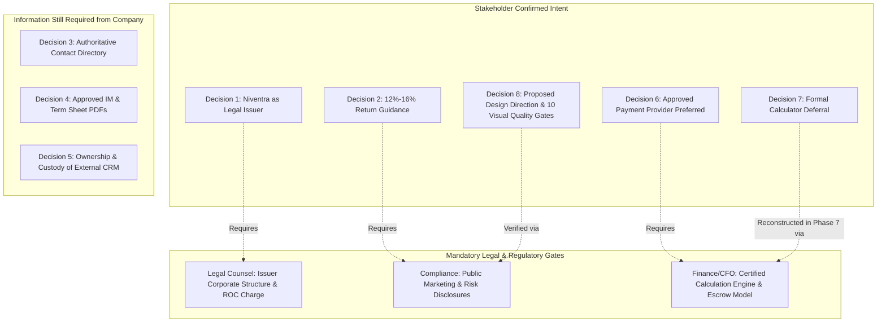

# Niventra Capital Advisory — Formal Decision Register

**Project Phase:** Phase 2 — Requirements Finalization & Architecture Planning  
**Date:** October 15, 2026  
**Auditor / Architect:** Senior Enterprise Software Architect & Financial Systems Auditor  
**Workspace:** `d:\Projects\niventra website`  
**Classification:** Enterprise Requirements Traceability & Governance Matrix  

---

## 1. Governance & Decision Framework

This Decision Register serves as the single source of truth for business requirements, operational parameters, and architectural constraints confirmed by the project stakeholder, while explicitly delineating them from **outstanding independent legal, financial, and regulatory verifications**.

In accordance with strict financial-services safeguards:
1. **Separation of Intent vs Verification:** A user-confirmed business intent establishes architectural direction but does **not** substitute for formal legal, compliance, or regulatory sign-off.
2. **No Hallucinated Registrations:** Antigravity does not fabricate regulatory license numbers (SEBI/RBI/MCA), tax identifiers, or corporate compliance status.
3. **No Premature Financial Execution:** Real-money payment processing, investor onboarding, and debenture allocation remain strictly disabled until all dependent governance gates are formally certified by authorized corporate reviewers.
4. **Defect Filtering & Deferral:** Untrustworthy calculation tools are formally deferred rather than deployed with known arithmetic or conceptual defects.

---

## 2. Master Decision Register (Decisions 1 through 8)

---

### DECISION 1 — ISSUER IDENTITY

| Attribute | Specification & Current Status |
| :--- | :--- |
| **Decision Identifier** | **DEC-01** |
| **Topic** | Corporate Role & Debenture Issuer Entity |
| **Business Intent Status** | **CONFIRMED BY USER (Phase 1.2):** Niventra Capital Advisory itself is intended to be the legal issuer of the initial debenture product. |
| **Legal Verification Status** | **PENDING INDEPENDENT VERIFICATION:** Not yet certified by company legal counsel or company secretary. |
| **Decision Source** | User Phase 1.2 Requirements Direction. |
| **Live Website Finding** | The live website on `/capital-providers/` currently states: *"Issuer Entity: Specific Special Purpose Vehicle (SPV) or Corporate Entity"*, and describes Niventra as an advisory/structuring intermediary. |
| **Reconciled Architectural Direction** | The platform architecture, data models, and database schemas will be designed around **Niventra as the direct issuing corporate entity**. However, debenture allocation and issuance workflows will remain programmatically gated until legal verification is completed. |
| **Remaining Dependencies** | 1. Legal counsel confirmation of the exact corporate entity name, CIN, registered office, and authorized capital under the Companies Act, 2013. 2. Corporate structure determination: Section 71 (Debentures), Section 42 (Private Placement of Securities), and Companies (Share Capital and Debentures) Rules, 2014. 3. Board resolution, Debenture Trustee appointment, ROC charge creation (Form CHG-9), and Debenture Redemption Reserve (DRR) compliance confirmation. |
| **Required Approver** | General Counsel / Managing Director / Company Secretary. |

---

### DECISION 2 — DEBENTURE RETURN GUIDANCE

| Attribute | Specification & Current Status |
| :--- | :--- |
| **Decision Identifier** | **DEC-02** |
| **Topic** | Debenture Return Range & Yield Guidance |
| **Business Intent Status** | **PRELIMINARY GUIDANCE PROVIDED (Phase 1.2):** Debenture returns are currently understood to fall within a range of **12% – 16%**. |
| **Compliance Status** | **UNVERIFIED PRELIMINARY GUIDANCE:** Not approved as a contractual coupon, audited performance metric, or public advertisement. |
| **Decision Source** | User Phase 1.2 Guidance Instruction. |
| **Live Website Finding** | Live website currently advertises **"14% - 16% per annum"** on `/debt-debenture/`, `/capital-providers/`, and `/`. Live hero slider computes 16% monthly compounding SIP returns. |
| **Reconciled Architectural Direction** | **Do NOT automatically overwrite live website copy with 12%–16%.** The live website's existing 14%–16% text is preserved in the baseline content inventory, while 12%–16% is cataloged in the decision register and financial review. Both figures are flagged as requiring formal compliance sign-off prior to Phase 4 public copy finalization. |
| **Remaining Dependencies** | 1. Specification of whether 12%–16% represents a fixed coupon rate, target IRR, or annualized gross yield. 2. Mapping of rates to specific debenture tenures and asset tranches. 3. Payout frequency determination (monthly, quarterly, annual, cumulative at maturity). 4. Compounding convention (simple interest vs compounding frequency). 5. Day-count convention (Actual/365, Actual/Actual, 30/360), holiday conventions, rounding, and tax deduction (TDS under Section 193/194A). 6. Legal and compliance approval of public marketing wording and mandatory co-located risk disclosure disclaimers. |
| **Required Approver** | Chief Compliance Officer & Chief Financial Officer. |

---

### DECISION 3 — OFFICIAL CONTACT INFORMATION

| Attribute | Specification & Current Status |
| :--- | :--- |
| **Decision Identifier** | **DEC-03** |
| **Topic** | Official Corporate Communication Channels |
| **Business Intent Status** | **UNRESOLVED:** Company-approved contact directory requested from company stakeholders. |
| **Decision Source** | Phase 1 Website Audit Finding. |
| **Identified Inconsistencies** | 1. **Toll-Free Phone:** `18008900818` (used in footer across 14 pages and `/contact/`). 2. **Delhi Landline:** `+91 01140515660` (displayed on `/debt-debenture/` and `/capital-providers/`, but the `href` dials `tel:18008900818`). 3. **WhatsApp Line:** `+91 74282 80200` (`https://wa.me/917428280200` on `/contact/`). 4. **Office Address:** `Patel Nagar City Centre, Gwalior, Madhya Pradesh - 474001` (generic unanchored map link). 5. **Emails:** `info@niventracapitaladvisory.com` (general) vs `grievance@niventracapitaladvisory.com` (grievance officer). |
| **Reconciled Architectural Direction** | In accordance with strict instructions, Antigravity does not arbitrarily select a preferred number or address. All identified numbers and addresses are preserved in the content inventory. Company management is requested to provide an authoritative corporate contact directory. |
| **Remaining Dependencies** | Authoritative, company-approved corporate contact directory defining primary telephone, landline, WhatsApp desk, physical office, and routing emails. |
| **Required Approver** | Head of Marketing & Customer Operations. |

---

### DECISION 4 — APPROVED OFFER DOCUMENTS & INVESTOR CLAUSES

| Attribute | Specification & Current Status |
| :--- | :--- |
| **Decision Identifier** | **DEC-04** |
| **Topic** | Offering Documents, Term Sheets & Policy Completeness |
| **Business Intent Status** | **UNRESOLVED:** Awaiting provision of verified, approved documents and missing copy from company stakeholders. |
| **Decision Source** | Phase 1 Website Audit Finding. |
| **Identified Deficiencies** | 1. **Missing Sample Offer Document:** `/assets/docs/sample_offer_document.pdf` returns HTML homepage (soft 404). 2. **Missing Sample Term Sheet:** `/assets/docs/sample_term_sheet.pdf` returns HTML homepage (soft 404). 3. **Truncated Investor Information:** `/investor-information/` renders only clauses 8, 11, and 12. Clauses 1, 2, 3, 4, 5, 6, 7, 9, and 10 are completely missing from the live page. |
| **Reconciled Architectural Direction** | Antigravity will **NOT** generate mock legal agreements, synthesize placeholder terms, or fabricate missing regulatory clauses. The document management architecture is configured to host PDF binaries securely once approved documents are provided. |
| **Remaining Dependencies** | 1. Official, redacted, watermarked sample Information Memorandum / Offer Document (PDF). 2. Official, redacted sample Debenture Term Sheet (PDF). 3. Complete authorized text for Clauses 1–7, 9, and 10 of the Investor Information policy. |
| **Required Approver** | Legal Counsel & Corporate Secretary. |

---

### DECISION 5 — EXTERNAL APPLICATION FORM STATUS & DATA GOVERNANCE

| Attribute | Specification & Current Status |
| :--- | :--- |
| **Decision Identifier** | **DEC-05** |
| **Topic** | Ownership, Custody & Replacement of External Application Link |
| **Business Intent Status** | **UNRESOLVED:** Formal inquiry submitted to company management regarding ownership and replacement strategy. |
| **Decision Source** | Phase 1 / Phase 1.1 Website Audit Finding. |
| **Verified Technical Facts** | 1. Link on `/capital-providers/`: `https://crm-teal-one-29.vercel.app/debenture-application?ref=MDSDWK-00I`. 2. Independent live probing confirmed the endpoint currently returns **`HTTP Error 404: Not Found`**. 3. Passive inspection was conducted without submitting personal or financial data. |
| **Reconciled Architectural Direction** | Architectural plan specifies replacing this external link with a **native, secure, first-party investor application workflow** hosted directly on the Niventra domain with PostgreSQL encrypted storage and DPDP compliance. Confirmation of ownership and authorization to decommission is requested from company management. |
| **Remaining Dependencies** | Company management confirmation of: 1. The legal or business owner of `crm-teal-one-29.vercel.app`. 2. The technical administrator and hosting account. 3. Data controller and processor arrangements. 4. Historical data collected, storage location, and access controls. 5. Authorization to permanently replace the link with the native Niventra onboarding portal. |
| **Required Approver** | Chief Information Security Officer (CISO) & Legal Counsel. |

---

### DECISION 6 — PAYMENT, SETTLEMENT & REGULATORY APPROVAL WORKFLOW

| Attribute | Specification & Current Status |
| :--- | :--- |
| **Decision Identifier** | **DEC-06** |
| **Topic** | Payment Gateway, Escrow Settlement & Allocation Separation |
| **Business Intent Status** | **BUSINESS DIRECTION CONFIRMED (Phase 1.2):** Preferred business direction is to use an approved payment / settlement provider, subject to product requirements and legal/compliance review. Provider selection and final settlement model remain unresolved. |
| **Compliance Status** | **STRICTLY GATED:** Zero real-money movement, live banking APIs, or investor payment collection will be activated until formal regulatory and banking approvals are certified. |
| **Decision Source** | User Phase 1.2 Guidance & Technical Architecture Safeguards. |
| **Core Architectural Rule** | **Strict Separation of Payment vs Issuance:** Successful receipt of investor funds through an approved payment/settlement provider updates the payment ledger to `CONFIRMED`, but does **NOT** automatically mark the debenture as issued or allocated. Allocation remains an independent corporate and legal event confirmed via debenture certificate generation or depository (NSDL/CDSL) credit. |
| **Remaining Dependencies** | 1. Determination of payment collection model: Designated Escrow Account vs Virtual Accounts (NEFT/RTGS) vs Corporate Net Banking vs Payment Aggregator (Razorpay / Cashfree / ICICI Eazypay). 2. Investor eligibility criteria (accredited investor thresholds, minimum subscription amount under private placement rules). 3. KYC/AML verification provider integration (Aadhaar/PAN verification, CKYC registry check). 4. Exception handling workflows: pending payments, reconciliation discrepancies, transaction failures, refunds, and coupon payouts. 5. Formal written sign-off from Legal, Finance, and Banking Operations. |
| **Required Approver** | Chief Financial Officer & Chief Compliance Officer. |

---

### DECISION 7 — FINANCIAL CALCULATOR DEFERRAL

| Attribute | Specification & Current Status |
| :--- | :--- |
| **Decision Identifier** | **DEC-07** |
| **Topic** | Formal Deferral of Financial Calculation Tools |
| **Business Intent Status** | **DEFERRED BY REQUIREMENT (Phase 2):** Reconstruction and implementation of financial calculators is formally deferred to a later phase (Phase 7). The existing calculator is recognized as unreliable and defective. |
| **Compliance Status** | **PROHIBITED FROM PUBLIC DEPLOYMENT:** No calculation widgets will be deployed on public production routes until financial models are certified in writing. |
| **Decision Source** | User Phase 2 Requirements Direction & Phase 1 Audit Evidence. |
| **Identified Defects Cataloged** | 1. **Equity SIP Formula in Debt Hero:** `assets/js/script.js` computes a 16% monthly compounding SIP formula on debentures. 2. **Arithmetic Contradiction on Bond Table:** `/capital-providers/` displays 14%–16% coupon on ₹50,000 for 1 month but outputs ₹50,360 (an implied 8.64% yield, whereas simple interest is ₹50,583.33 at 14% and ₹50,666.67 at 16%). 3. **Non-Standard Day-Count:** `/calculator/` uses an informal 30-day divisor without leap year or Actual/365 handling. 4. **Zero TDS Modeling:** Gross returns displayed without statutory 10% tax withholding disclosures. |
| **Preservation Rule** | Legacy calculator scripts (`calculator.js`, `calculator.css`, `script.js`) are archived bit-for-bit in `preserved-assets/` for historical reference, but will not be active on public routes. |
| **Remaining Dependencies** | Written certification from CFO/Structuring Lead covering: exact mathematical formula (simple vs compound), day-count convention (Actual/365 or 30/360), payout frequencies, and TDS toggles. |
| **Required Approver** | Chief Financial Officer / Head of Structuring. |

---

### DECISION 8 — PROPOSED DESIGN DIRECTION, ACCESSIBILITY CONTRAST & VISUAL QUALITY GATES

| Attribute | Specification & Current Status |
| :--- | :--- |
| **Decision Identifier** | **DEC-08** |
| **Topic** | Premium Visual Direction, Palette Contrast Evaluation, Typography & 10 Visual Quality Gates |
| **Business Intent Status** | **PROPOSED DESIGN SPECIFICATION (Phase 2):** To establish Niventra as an award-worthy, visually distinctive financial services platform, an institutional design direction is proposed and detailed in `docs/phase-2-design-direction.md` and `docs/phase-2-visual-quality-gates.md`. |
| **Design Status** | **PROPOSED CHOICE (SUBJECT TO USER REVIEW):** The color palette (Midnight Navy `#0B192C`, Slate Blue `#1E3E62`, Warm Gold `#D4AF37`, Light Gray `#F8F9FA`) and typography (`Playfair Display` + `Plus Jakarta Sans`) are formally treated as evaluated design choices, not rigid assumptions. |
| **Contrast & Readability Audit Findings** | 1. **White on Navy (`#FFFFFF` on `#0B192C`):** Contrast ratio **16.2:1** (WCAG AAA Pass). 2. **Navy on Light Gray (`#0B192C` on `#F8F9FA`):** Contrast ratio **15.4:1** (WCAG AAA Pass). 3. **Charcoal on Light Gray (`#1F2937` on `#F8F9FA`):** Contrast ratio **12.4:1** (WCAG AAA Pass). 4. **Warm Gold on Navy (`#D4AF37` on `#0B192C`):** Contrast ratio **7.4:1** (WCAG AAA Pass for large headings, AA Pass for normal text). 5. **CRITICAL RESTRICTION:** Warm Gold on White (`#D4AF37` on `#FFFFFF`) yields **2.2:1** (FAILS WCAG AA). Therefore, `#D4AF37` is banned for body text on light backgrounds; deep gold `#997300` (4.6:1) or dark text must be used. |
| **Typography Rationale** | Editorial serif (`Playfair Display`) delivers corporate advisory gravitas and prestige, while geometric sans (`Plus Jakarta Sans` or `Inter`) provides data clarity, tabular numerals (`tnum`), and effortless readability across dense legal disclosures. |
| **Quality Gate Adoption** | The 10 Measurable Quality Gates in `docs/phase-2-visual-quality-gates.md` (Visual Polish, WCAG 2.1 AA Contrast, Typography Scale, 60fps Micro-Motion, Multi-Device Responsive Matrix, 8 Component States, Asset Integrity, Content Parity Scraper, Zero Broken Links, Lighthouse Score ≥ 95) are formally adopted. |
| **Required Approver** | Project Stakeholder / Creative Director / Head of Compliance. |

---

## 3. Decision Traceability Matrix for Downstream Phases

| Phase | Relevant Decisions | Prerequisite Gate Condition |
| :--- | :---: | :--- |
| **Phase 2** (Requirements Sign-Off) | DEC-01 to DEC-08 | Executive, Legal & Compliance review of this Decision Register. |
| **Phase 3** (Foundations & Design System)| DEC-01, DEC-03, **DEC-08** | Implement Design Tokens, typography, and component library meeting the 10 Visual Quality Gates. |
| **Phase 4** (Public Website Rebuild) | DEC-02, DEC-03, DEC-04, DEC-07, **DEC-08** | Public copy approved; all 16 routes reconstructed with 100% content parity; calculator omitted/deferred. |
| **Phase 5** (Auth & Admin Portals) | DEC-01, DEC-05, DEC-08 | First-party investor application schema approved; accessible dashboard components. |
| **Phase 7** (Product Catalogue & Calculator)| **DEC-01, DEC-02, DEC-07** | Debenture terms, yield model, compounding, and day-count certified by CFO. |
| **Phase 8** (Payments & Settlement) | **DEC-01, DEC-06** | **Mandatory Regulatory Escrow Gate:** Written sign-off on payment provider, escrow agreement, and allocation separation. |
| **Phase 9** (QA & Visual Verification) | **DEC-08** | **Comprehensive Quality Audit:** 100% automated axe-core pass, Lighthouse CI ≥ 95, Playwright E2E verification. |
