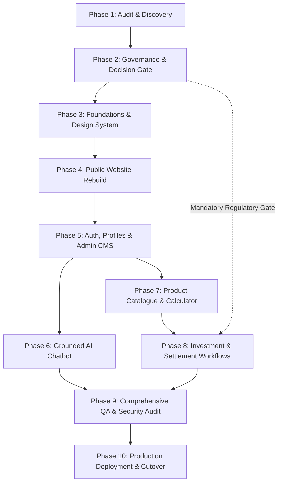

# Niventra Capital Advisory — Phased Implementation Plan & Technical Roadmap

**Audit Date:** October 15, 2026  
**Auditor:** Senior Software Architect & Technical Program Manager  
**Target Domain:** `https://niventracapitaladvisory.com`  
**Classification:** Strategic Architectural Roadmap & Execution Plan  

---

## 1. Executive Implementation Strategy

The rebuild of the Niventra Capital Advisory platform requires a disciplined, multi-stage engineering roadmap designed to:
1. **Preserve Complete Brand & Content Parity:** Ensure 100% preservation of all approved copy, legal disclosures, and visual assets before introducing advanced digital services.
2. **Enforce Strict Compliance & Governance Gates:** Prevent premature development or activation of real-money transactions, investor onboarding, or referral compensation until regulatory authorizations and offering documents are certified.
3. **Establish a Modern, Secure Architectural Foundation:** Transition from a legacy static/PHP footprint to an enterprise-grade stack (Next.js, TypeScript, PostgreSQL, Prisma, TailwindCSS/Vanilla CSS tokens, server-side RAG).
4. **Isolate Environments:** Ensure zero disruption to the active live website during all development and staging phases.

*Note: All timeline and complexity estimates in this roadmap are strictly provisional and subject to formal stakeholder review and approval.*

---

## 2. Phased Delivery Roadmap (Phase 1 to Phase 10)

---

### Phase 1: Environment Discovery, Skill Review, Website Audit & Architecture Planning
- **Status:** **COMPLETED (Current Turn)**
- **Objectives:** Discover installed runtimes and agent skills, crawl all 16 live website routes, catalog all assets, analyze forms/scripts/calculators, uncover legal/financial discrepancies, and establish baseline documentation.
- **Deliverables:**
  - `docs/skills-and-environment-report.md`
  - `docs/route-inventory.md`
  - `docs/content-inventory.csv`
  - `docs/asset-inventory.md`
  - `docs/link-and-functionality-audit.md`
  - `docs/financial-and-legal-review.md`
  - `docs/content-parity-checklist.md`
  - `docs/open-questions.md`
  - `docs/implementation-plan.md`
  - `docs/website-audit.md`
- **Dependencies:** None.
- **Estimated Complexity:** Moderate (Completed).

---

### Phase 2: Requirements Reconciliation, Decision Register & Architecture Finalization
- **Status:** **DOCUMENTED & ARCHITECTED (Phase 2 Deliverables Complete)**
- **Objectives:** Formalize project requirements, technology stack evaluation, security plan, testing strategy, environment plan, feature boundaries, and decision register:
  - `docs/phase-2-requirements.md`: Detailed functional and non-functional requirements, boundary definitions (Categories A, B, C), and calculator deferral catalog.
  - `docs/phase-2-architecture.md`: Comprehensive system architecture (Next.js 15 App Router, TypeScript, PostgreSQL, Prisma, `pgvector`), component designs, and Prisma schema.
  - `docs/phase-2-security-plan.md`: Security architecture, OWASP Top 10 mitigation, DPDP Act 2023 compliance, RAG AI firewall, and payment guardrails.
  - `docs/phase-2-testing-strategy.md`: Multi-tier testing pyramid, automated content parity validation, WCAG 2.1 AA a11y testing, and CI quality gates.
  - `docs/phase-2-environment-plan.md`: Environmental isolation (live untouched), Git branch protection, secret management, and zero-downtime cutover runbook.
  - `docs/phase-2-feature-dependencies.md`: Traceability matrix and feature flags governing Category A (immediate), Category B (staged), and Category C (strictly gated).
  - `docs/decision-register.md`: Master traceability matrix for Decisions 1–7 (including DEC-07 Calculator Deferral).
- **Acceptance Criteria:** Formal presentation of architecture, requirements, and governance registers to executive stakeholders; explicit authorization to initialize Phase 3 engineering workspace.
- **Dependencies:** Delivery of Phase 1, Phase 1.1, Phase 1.2, and Phase 2 documentation.
- **Estimated Complexity:** Low technical / High organizational governance.

---

### Phase 3: Development Workspace, Architecture Foundations & Design System
- **Status:** **PLANNED (Awaiting Phase 2 Approval)**
- **Objectives:**
  - Initialize clean development workspace with Git version control, branch protection (`main`, `staging`, `feature/*`), and CI/CD pipelines.
  - **Mandatory Skill Inspection & Usage:** Inspect and apply actual instructions from `permissioned-github` (for branch escalation and Git workflows) and `agy-customizations` (for workspace rules in `.agents/`). Record evidentiary logs of skill read events.
  - Setup Next.js 15+ (App Router), React 19, TypeScript (strict mode), and ESLint/Prettier configurations.
  - **Construct Institutional Design System (`docs/phase-2-design-direction.md`):**
    - Implement evaluated design tokens: Primary Navy (`#0B192C`), Slate Blue (`#1E3E62`), Accent Warm Gold (`#D4AF37` with Deep Gold `#997300` text rule), Off-White (`#F8F9FA`), and Charcoal (`#1F2937`).
    - Typography tokens with Google Fonts (`Playfair Display` for editorial headings + `Plus Jakarta Sans` or `Inter` for data/body).
    - Accessible form controls (floating labels, focus rings, inline error states), elevation cards, modal dialogs, and 60fps micro-motion (`prefers-reduced-motion` compliant).
  - Setup Vitest / Jest unit testing framework, Playwright end-to-end framework, and `@axe-core/playwright`.
- **Acceptance Criteria:** Component storybook/library satisfying Gate 1 (Visual Polish), Gate 2 (WCAG 2.1 AA Contrast), Gate 4 (Motion), and Gate 6 (8 Component States) of `docs/phase-2-visual-quality-gates.md` with 0 TypeScript errors.
- **Dependencies:** Phase 2 stakeholder approval of architecture and design specifications.
- **Estimated Complexity:** Moderate.
- **Provisional Duration:** 2 Weeks.

---

### Phase 4: Public Website Reconstruction & Content Parity Verification
- **Status:** **PLANNED**
- **Objectives:**
  - Reconstruct all 16 canonical public routes with 100% content parity against `docs/content-parity-checklist.md` and route specifications in `docs/phase-2-design-direction.md`.
  - **Zero-Login Public Access:** Ensure 100% of corporate, educational, disclosure, and contact pages are immediately accessible without authentication.
  - Incorporate original `logo.png` (1355 × 1160 px, 671.6 KB) bit-for-bit without lossy compression or modification.
  - Convert brand graphics (`bond-plant.png`, `premium_corporate_real_estate.png`, etc.) to modern lossless WebP with Retina display density.
  - Correct all UTF-8 mojibake encoding errors (`₹` -> `₹`, `©` -> `©`, `–` -> `–`).
  - Deploy native Next.js Server Actions for contact intake with Cloudflare Turnstile bot protection and email alerts.
  - Eliminate dead PDF soft-404 loops; implement verified document holding cards.
  - **Enforce Calculator Deferral (DEC-07):** Standalone calculator and hero SIP slider are omitted from public deployment. The `/calculator/` path will render an informative holding notice until certified terms are implemented in Phase 7.
  - Configure dynamic `sitemap.xml`, `robots.txt`, OpenGraph metadata, and structured JSON-LD (`Organization`, `FinancialService`).
- **Acceptance Criteria:** Complete verification pass against all 10 Quality Gates in `docs/phase-2-visual-quality-gates.md`. Zero broken links, zero missing sections, 100% WCAG 2.1 AA pass, 95+ Google Lighthouse scores across Performance, Accessibility, Best Practices, and SEO.
- **Dependencies:** Phase 3 component foundations.
- **Estimated Complexity:** High.
- **Provisional Duration:** 3 Weeks.

---

### Phase 5: Authentication, User Profiles, Admin CMS & Document Management
- **Status:** **PLANNED**
- **Objectives:**
  - Deploy secure identity provider (Auth0 / Clerk or Argon2id/iron-session in PostgreSQL).
  - Implement user registration, email verification (SendGrid/Resend), password reset, and secure session management.
  - Build Role-Based Access Control (RBAC): `INVESTOR`, `DEVELOPER`, `ADMIN`, `COMPLIANCE_OFFICER`.
  - Develop Investor Dashboard (profile verification status, document repository, application history, support tickets).
  - Develop Admin Portal (user management, lead CRM, document version control, grievance tracking with 48h/30d SLA indicators, audit logs).
  - Implement automated Account Deletion request workflow adhering to DPDP Act 2023 and regulatory data retention exceptions.
- **Acceptance Criteria:** Successful multi-role authentication, encrypted session cookies, OWASP ASVS Level 2 compliance, and verified RBAC enforcement on all protected API routes.
- **Dependencies:** Phase 4 public platform and Phase 2 auth architecture selection.
- **Estimated Complexity:** Very High.
- **Provisional Duration:** 4 Weeks.

---

### Phase 6: Grounded AI Chatbot & Knowledge Retrieval Engine (RAG)
- **Status:** **PLANNED**
- **Objectives:**
  - Implement server-side RAG pipeline using PostgreSQL with `pgvector` extension.
  - Index exclusively verified, approved company documentation (website copy, approved FAQs, redacted offering term sheets).
  - Enforce deterministic guardrails:
    - Never invent interest rates, company facts, or regulatory licenses.
    - Zero individualized financial advice without human advisor disclaimers.
    - Mandatory source citation links for every generated answer.
    - Graceful fallback: *"I do not have verified company information on that topic. Would you like to speak with our advisory team?"*
    - Prompt injection defenses and sanitized input parsing.
    - Optional WhatsApp / ticket handoff.
    - English and Hindi bilingual query recognition.
- **Acceptance Criteria:** 100% adherence to grounding corpus in automated adversarial testing; zero hallucinations on unapproved rates; zero browser exposure of model API keys.
- **Dependencies:** Phase 4 approved content corpus and Phase 5 API infrastructure.
- **Estimated Complexity:** High.
- **Provisional Duration:** 2 – 3 Weeks.

---

### Phase 7: Product Catalogue & Institutional Financial Calculators (Unblocking Deferred Calculator)
- **Status:** **PLANNED (Unblocks Deferred Calculator via DEC-07)**
- **Prerequisite Gate:** *Zero calculator deployment until CFO formally certifies mathematical models, day-count basis, and TDS rules in writing.*
- **Objectives:**
  - Implement dynamic PostgreSQL product catalogue supporting Debentures, Real Estate Projects, and future asset classes with Niventra as the designated issuing entity.
  - Support discrete product states: `Draft`, `Coming Soon`, `Available`, `Suspended`, `Closed`.
  - Display strictly approved product terms; enforce that "Coming Soon" products cannot accept applications.
  - **Reconstruct and Deploy Certified Financial Calculator (DEC-07):**
    - Replace the defective legacy SIP script and unverified bond example with a mathematically verified Debenture Yield Calculator.
    - Certified parameters: Principal, Coupon Rate (incorporating preliminary 12%–16% guidance once finalized by finance), Tenure (months/years), Payout Frequency (Monthly, Quarterly, Annual, Maturity).
    - Standard day-count conventions (Actual/365, 30/360) and explicit TDS deduction toggles (10% standard withholding).
    - Number-to-words Indian Rupee conversion.
    - Mandatory co-located illustrative disclaimer: *"Calculations are for illustrative projections only and do not constitute an offer, contract, or guaranteed yield."*
- **Acceptance Criteria:** Calculation engine outputs mathematically verified by CFO/Structuring Lead against spreadsheet models down to the exact rupee.
- **Dependencies:** Phase 2 financial formula sign-off (DEC-02, DEC-07) and Phase 5 database models.
- **Estimated Complexity:** Moderate to High.
- **Provisional Duration:** 2 – 3 Weeks.

---

### Phase 8: Investment, Settlement, Referral & Payout Workflows (Conditional Gate)
- **Status:** **STRICTLY GATED (Conditional on Regulatory & Corporate Approval)**
- **Mandatory Prerequisite:** *Zero development or live activation until issuer structure (Decision 1), KYC/AML obligations, payment gateway compliance, escrow agreements (Decision 6), and referral legality are formally certified in writing.*
- **Objectives (Upon Explicit Approval):**
  - Preferred business direction is to integrate an approved payment / settlement provider, subject to product requirements and legal/compliance review (provider selection and final settlement model unresolved).
  - Multi-step investment application flow: Investor eligibility questionnaire, accredited investor check, PAN/Aadhaar KYC integration via verified vendor (e.g., Digio/Signzy).
  - Secure payment initiation with designated institutional gateway / escrow API (NEFT/RTGS virtual accounts / ICICI Eazypay).
  - Idempotent webhook listener processing payment states: `Pending`, `Confirmed`, `Failed`, `Refunded`.
  - **Core Architectural Guardrail (Payment vs Issuance Separation):** Successful receipt of funds through the approved provider records a `CONFIRMED` payment transaction, but does **not** automatically mark the debenture as issued or allocated. Debenture issuance and allocation remain an independent corporate/legal event confirmed via debenture certificate generation or depository (NSDL/CDSL) credit.
  - Referral subsystem (if legally cleared): Unique referral links, anti-self-referral prevention, qualifying threshold rules, pending/approved/paid/reversed ledger, and automated TDS Section 194H tracking.
- **Acceptance Criteria:** End-to-end sandbox payment reconciliation, double-entry ledger verification, automated audit logging, and signed sign-off from Legal, Finance, and CISO.
- **Dependencies:** Written authorization from Board & Compliance (Decisions 1 & 6); Phase 5 and Phase 7 completion.
- **Estimated Complexity:** Very High.
- **Provisional Duration:** 4 – 5 Weeks.

---

### Phase 9: Comprehensive QA, Security Penetration & User Acceptance Testing
- **Status:** **PLANNED**
- **Objectives:**
  - Automated regression suite via Playwright covering all 16 public routes, user flows, and forms.
  - Rigorous content parity re-verification against `docs/content-parity-checklist.md`.
  - Static and Dynamic Application Security Testing (SAST/DAST): OWASP Top 10, penetration testing, dependency audit (`npm audit`), CSP enforcement, and rate-limit stress tests.
  - **Full Certification of the 10 Quality Gates (`docs/phase-2-visual-quality-gates.md`):** Visual Polish, WCAG 2.1 AA Contrast, Typography Scale, 60fps Micro-Motion, Multi-Device Responsive Matrix, 8 Component States, Asset Fidelity, Content Parity, Link Health, and Web Vitals.
  - Cross-browser and device testing (Chrome, Safari, Firefox, Edge; iOS and Android mobile viewports).
  - Formal User Acceptance Testing (UAT) with company executives, compliance team, and operations personnel.
- **Acceptance Criteria:** 0 Critical or High severity vulnerabilities; 100% pass across all 10 Quality Gates in `docs/phase-2-visual-quality-gates.md`; formal UAT acceptance document signed.
- **Dependencies:** Completion of target build phases.
- **Estimated Complexity:** High.
- **Provisional Duration:** 2 – 3 Weeks.

---

### Phase 10: Production Cutover, Monitoring & Post-Launch Support
- **Status:** **PLANNED**
- **Mandatory Prerequisite:** *Explicit written authorization from executive management.*
- **Objectives:**
  - Establish production cloud infrastructure (Vercel Enterprise / AWS ECS, Managed PostgreSQL on Supabase/AWS RDS, Cloudflare Enterprise CDN).
  - Provision automated daily backups with Point-In-Time-Recovery (PITR).
  - Configure uptime monitoring, error alerting (Sentry), APM tracing, and security log aggregation.
  - Execute DNS cutover with zero downtime: Update Cloudflare DNS A/CNAME records to new production target.
  - Post-launch verification: Live smoke tests, SSL/TLS handshake inspection, HSTS validation, and sitemap re-submission to Google Search Console.
- **Acceptance Criteria:** Seamless cutover with 0 HTTP 5xx errors, sub-second TTFB globally, and active 24/7 monitoring alerting.
- **Dependencies:** Phase 9 UAT sign-off and written deployment authorization.
- **Estimated Complexity:** Moderate.
- **Provisional Duration:** 1 Week.

---

## 3. Technical Complexity & Effort Summary

| Phase | Focus Area | Technical Complexity | Core Dependencies | Gate Condition |
| :--- | :--- | :---: | :--- | :--- |
| **Phase 1** | Audit, Discovery & Architecture | Moderate | None | Completed |
| **Phase 2** | Requirements & Governance Sign-Off | Low Tech / High Org | Phase 1 Audit Docs | **Decision Gate** |
| **Phase 3** | Workspace, Design System & Tooling | Moderate | Phase 2 Sign-Off | Code Quality Gate |
| **Phase 4** | Public Website Rebuild | High | Phase 3 Design System | Content Parity Gate |
| **Phase 5** | Auth, Portals & Admin CMS | Very High | Phase 4 Platform | Security ASVS Gate |
| **Phase 6** | Grounded AI Chatbot | High | Phase 4 Corpus | Hallucination Gate |
| **Phase 7** | Product Catalogue & Calculator | Moderate-High | Phase 2 Financial Sign-Off | Math Verification Gate |
| **Phase 8** | Payments & Settlement (Gated) | Very High | **Explicit Legal Sign-Off** | **Regulatory Escrow Gate** |
| **Phase 9** | QA, Security & UAT | High | All Code Complete | UAT Sign-Off Gate |
| **Phase 10** | Production Cutover | Moderate | Phase 9 Sign-Off | **Written Deployment Auth** |
