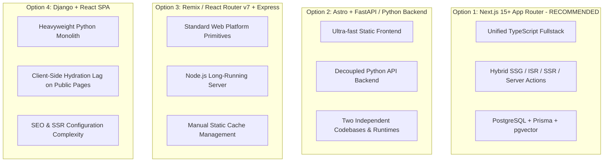
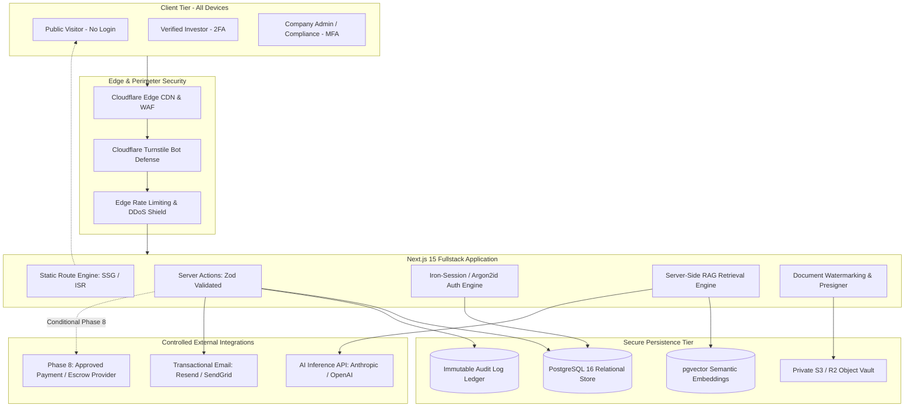
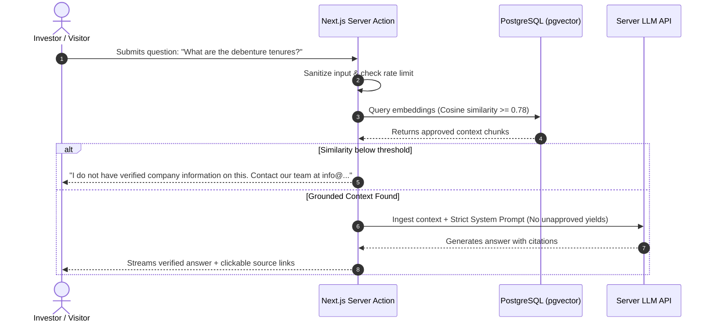
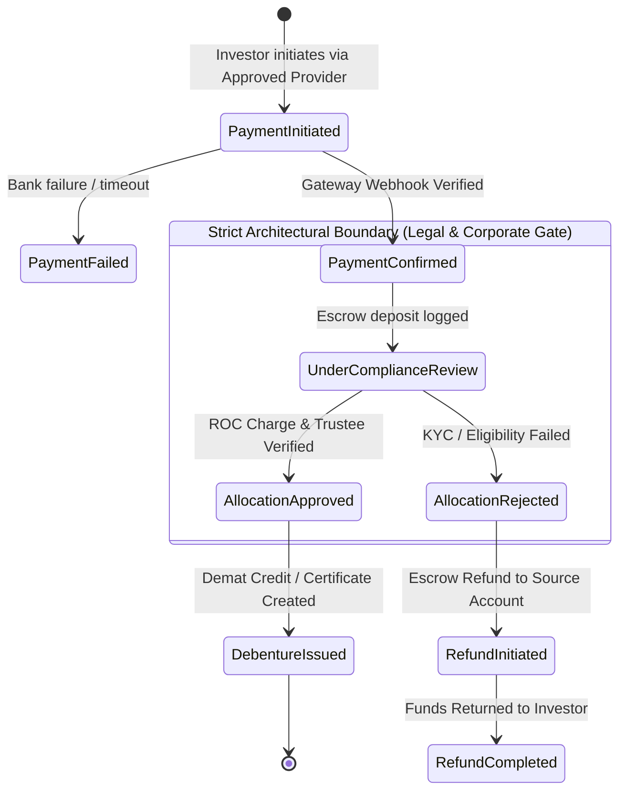

# Niventra Capital Advisory — Phase 2 Technical Architecture & System Design

**Document Reference:** `docs/phase-2-architecture.md`  
**Project Phase:** Phase 2 — Requirements Finalization & Architecture Planning  
**Date:** October 15, 2026  
**Author:** Senior Enterprise Software Architect & Systems Security Engineer  
**Workspace:** `d:\Projects\niventra website`  
**Classification:** Enterprise System Architecture & Technology Evaluation  

---

## 1. Executive Architectural Vision & Objectives

The planned rebuild of the official Niventra Capital Advisory platform (`https://niventracapitaladvisory.com/`) transitions the company from an unmaintained, static HTML/PHP deployment with fragmented third-party links into an institutional-grade, unified financial web platform.

### Core Architectural Mandates:
1. **Public Accessibility Without Friction:** All 16 public marketing, educational, and statutory disclosure routes must remain publicly accessible without login or registration barriers.
2. **Defect-Free Content Preservation:** Maintain 100% parity with existing legitimate copy, disclaimers, and authentic brand assets, while filtering out known arithmetic errors, dead download links, and corrupted characters.
3. **Rigorous Financial & Legal Gating:** Build architectural guardrails that strictly separate non-financial public content from gated investment workflows. Real-money movement and debenture allocation must remain programmatically disabled until legal and compliance certifications are filed.
4. **Deterministic Grounded AI Knowledge Retrieval:** Deploy an in-house server-side Retrieval-Augmented Generation (RAG) assistant grounded exclusively in verified corporate literature, eliminating hallucinations on financial yields or regulatory claims.
5. **Data Sovereignty & DPDP Compliance:** Eliminate off-domain unbranded redirects for investor applications, bringing all data collection directly into a secure, encrypted first-party database architecture conforming to the Digital Personal Data Protection (DPDP) Act, 2023.

---

## 2. Technology Stack Evaluation & Comparative Analysis

To identify the optimal architectural foundation, four enterprise web architectures were comparatively evaluated against Niventra's requirements:



### 2.1 Comparative Analysis Matrix

| Evaluation Dimension | Option 1: Next.js 15+ (App Router) + PostgreSQL (Recommended) | Option 2: Astro Frontend + FastAPI / Python Backend | Option 3: Remix / React Router v7 + Node.js | Option 4: Django REST + React SPA |
| :--- | :--- | :--- | :--- | :--- |
| **Public Route Performance (SSG/ISR)** | **Exceptional:** Native Static Site Generation with Incremental Static Regeneration generates static HTML at build time for all 16 public routes, serving sub-50ms TTFB via Edge CDN. | **Exceptional:** Zero-JS default static generation provides best-in-class static performance. | **Moderate:** Relies primarily on dynamic SSR with edge caching; requires manual cache headers and invalidation logic. | **Poor:** Client-side SPA rendering results in initial loading spinners, high LCP, and poor SEO indexing. |
| **Codebase & Type Safety** | **Single Unified Repo:** End-to-end TypeScript from database models (Prisma) through Server Actions to React 19 UI components. Zero API drift. | **Fragmented:** Split between TypeScript (Astro) and Python (FastAPI). Requires OpenAPI schema codegen and duplicate DTO types. | **Single Unified Repo:** End-to-end TypeScript across loaders and actions. Strong type safety. | **Fragmented:** Python backend and TypeScript frontend; requires DRF serializers and frontend type generation. |
| **Grounded AI (RAG) Integration** | **Native Unified Storage:** PostgreSQL with `pgvector` handles relational data and document embeddings in a single database. Server Actions execute LLM calls securely server-side. | **Strong Python AI Ecosystem:** Native Python LangChain/LlamaIndex, but introduces two separate databases or network serialization overhead. | **Moderate:** Can use `pgvector` with Node.js LLM SDKs, but requires custom orchestration plumbing. | **Strong Python AI Ecosystem:** Native Python libraries, but heavy infrastructure footprint. |
| **Security & Attack Surface** | **Hardened:** No browser exposure of secrets; Server Actions provide built-in CSRF protection; strict HTTP-only cookies; fine-grained middleware RBAC. | **Complex Perimeter:** Dual endpoints (Frontend CDN + Python API) require cross-origin CORS, token management, and separate WAF rules. | **Hardened:** Strong cookie and session primitives; minimal browser exposure. | **Complex Perimeter:** Token refresh rotations, CORS headers, and client-side token storage vulnerabilities. |
| **Infrastructure & Operational Cost** | **Low to Moderate:** Can be hosted on Vercel Enterprise or AWS ECS (Docker) with managed PostgreSQL (Supabase / Neon / AWS RDS). ~$50–$150/mo. | **High:** Requires two distinct hosting environments (Static Host + Python container runtime). ~$120–$250/mo. | **Moderate:** Node.js long-running container on AWS ECS or Railway. ~$80–$180/mo. | **High:** Heavyweight Django app server, Celery worker, Redis, and static CDN hosting. ~$150–$300/mo. |
| **Long-Term Maintainability** | **High:** Largest enterprise React ecosystem, rich component libraries, unified dependency graph. | **Moderate:** Two language stacks (JS/TS + Python) require dual developer skillsets for maintenance. | **Moderate:** Smaller ecosystem and fewer turnkey enterprise plugins than Next.js. | **Moderate:** High boilerplate overhead for simple form handling and SEO configuration. |

### 2.2 Selected Architecture & Rationale
**Selected Stack: Next.js 15+ (App Router), React 19, TypeScript, PostgreSQL 16+, Prisma ORM, and `pgvector`.**

**Justification:**
1. **Zero Compromise on Public SEO & Performance:** Allows all 16 public routes to be statically generated (SSG) with instantaneous load times, zero client-side layout shifts (CLS < 0.05), and perfect Google Search Console indexing.
2. **Unified Data Architecture:** PostgreSQL serves as the single source of truth for relational business records (investor profiles, leads, grievances, product catalogue) and vector embeddings (`pgvector`), eliminating the need for expensive external vector databases (e.g., Pinecone).
3. **End-to-End Type Safety:** A single TypeScript codebase guarantees that database schema changes immediately flag compile-time errors in server mutations and UI forms, preventing runtime errors in financial workflows.
4. **Server-Side Security Enclave:** Server Actions and Route Handlers keep all sensitive logic, document presigning, and AI prompt engineering on the server, ensuring zero API keys or business formulas leak to client browsers.

---

## 3. Subsystem Architecture & Detailed Component Design



### 3.1 Public Website & Content Presentation Subsystem
- **Rendering Model:** Static Site Generation (SSG) at build time with Incremental Static Regeneration (ISR) revalidation window of 3600 seconds.
- **Visual Design Architecture (`docs/phase-2-design-direction.md`):** Institutional Design System implemented via CSS variables / Tailwind tokens with mathematically verified contrast (Midnight Navy `#0B192C`, Slate Blue `#1E3E62`, Warm Gold `#D4AF37` with Deep Gold `#997300` text rule, Pearl `#F8F9FA`, Charcoal `#1F2937`).
- **Typography Engine:** Dual font pairing: Editorial serif (`Playfair Display`) for authoritative headings and geometric sans (`Plus Jakarta Sans` or `Inter`) for data, numbers, and disclosures.
- **Visual Quality Gate Compliance (`docs/phase-2-visual-quality-gates.md`):** Must satisfy all 10 measurable visual quality gates, including WCAG 2.1 AA contrast, 60fps micro-motion (`prefers-reduced-motion` override), 8 component states, zero horizontal scroll across 360px–4K viewports, and Lighthouse scores ≥ 95.
- **Asset Pipeline:** Next.js `<Image>` component utilizing modern WebP/AVIF formats with responsive `srcset` generation. Original `logo.png` (1355×1160 px) is preserved verbatim and served with lossless compression.
- **Encoding Sanitizer:** Build-time linting enforcing UTF-8 Unicode compliance across all static strings.

### 3.2 User Authentication, Profiles & Role-Based Access Control (RBAC)
- **Authentication Engine:** Self-hosted, hardened session architecture utilizing **Argon2id** password hashing and encrypted, HTTP-only, `SameSite=Strict`, `Secure` session cookies (via `iron-session` or sealed JWTs).
- **MFA Protocol:** Time-based One-Time Password (TOTP via RFC 6238) or secure email magic links for administrative and investor logins.
- **RBAC Matrix:**
  - `INVESTOR`: Read-only access to own profile, access to watermarked offering documents, ticket creation, application history.
  - `DEVELOPER`: Read-only access to project due diligence milestones.
  - `ADMIN`: Write access to lead CRM, grievance management, product catalogue states (`Draft`, `Coming Soon`), document management.
  - `COMPLIANCE_OFFICER`: Sole authorization to publish `Available` products, certify offer documents, and inspect immutable audit logs.
- **DPDP Account Erasure Pipeline:** Automated queue that masks PII upon request while preserving statutory financial audit logs under the Companies Act and PMLA regulations.

### 3.3 Investor Dashboard & Administrative CMS
- **Investor Console:** React Server Component dashboard providing real-time tracking of enquiry statuses, verified profile parameters, and the secure document vault.
- **Administrative CMS:**
  - Lead Intake Console: Centralized table of enquiries with status filters (`New`, `Contacted`, `Under Review`, `Archived`).
  - Statutory Grievance Tracker: Automated SLA monitors displaying color-coded timers (Green < 24h, Amber 24–40h, Red > 40h for acknowledgment; 30-day resolution countdown).
  - Product Stage Controller: Restricted toggle requiring two-person sign-off (Admin + Compliance) to transition a product to `Available`.

### 3.4 Product Catalogue Subsystem
- **Catalogue Schema:** Models Debentures and Real Estate Projects with explicit metadata (Issuer Legal Entity, Face Value, Collateral Description, Target Tenure, Risk Tier).
- **State Machine Enforcement:**
  $$\text{Draft} \xrightarrow{\text{Admin}} \text{Coming Soon} \xrightarrow{\text{Compliance Cert}} \text{Available} \xrightarrow{\text{Maturity / Cap}} \text{Closed}$$
- Products in `Draft` or `Coming Soon` state physically cannot generate application or payment sessions in the API layer.

### 3.5 Grounded AI Knowledge Assistant (RAG Pipeline)
- **Vector Embedding Store:** PostgreSQL using the `pgvector` extension with Cosine Distance (`vector_cosine_ops`) indexing over 1536-dimensional or 768-dimensional embeddings.
- **Grounding Corpus:** Strict indexing restricted to approved public pages, published FAQs, and authorized offering summaries. Internal draft notes or unapproved figures are excluded.
- **Inference Pipeline:**
  1. User query is sanitized against prompt injection patterns.
  2. Query embedding is generated and matched against `pgvector` (minimum similarity threshold: 0.78).
  3. Context chunks are assembled into a deterministic system prompt with strict negative constraints: *"If the answer cannot be verified from the provided context, state that you do not have verified company information and provide the advisory team contact link. Never quote interest rates not in the context."*
  4. Response is streamed to the client with clickable citations.



### 3.6 Secure Document Management & Watermarking
- **Object Vault:** AWS S3 or Cloudflare R2 bucket configured with Private ACL, block public access, and server-side encryption with AWS KMS (SSE-KMS).
- **Access Controller:** Next.js Route Handler validates user identity and RBAC permissions before generating a cryptographically signed URL valid for exactly 15 minutes.
- **Dynamic PDF Watermarking:** Upon download request, a server-side PDF utility (using `pdf-lib`) dynamically overlays a semi-transparent, diagonal watermark across each page:  
  `CONFIDENTIAL — PREPARED FOR [INVESTOR EMAIL] — [TIMESTAMP] — NOT FOR REDISTRIBUTION`

### 3.7 Statutory Grievance Redressal Engine
- **Intake Flow:** Validates complainant identity, contact coordinates, reference number, and grievance classification.
- **Automated SLA Engine:**
  - Ingests grievance and writes record to PostgreSQL.
  - Automatically dispatches an official Acknowledgment Email within **48 hours** containing a unique tracking code (e.g., `NIV-GRV-2026-0042`).
  - Sets automated cron triggers: at Day 15, sends progress status update; at Day 25, flags critical alert to Grievance Redressal Officer; at Day 30, logs compliance SLA compliance or breach.

### 3.8 Payment vs Debenture Issuance Separation (Phase 8 Architecture)
To enforce absolute regulatory and financial protection, the system establishes a strict architectural separation between **Payment Ledgering** and **Legal Debenture Issuance**:



- **Rule 1:** A `CONFIRMED` payment status records only that funds have arrived in the designated escrow account. It does **NOT** create a legal debenture obligation.
- **Rule 2:** The `DebentureAllocation` table can only be modified by a multi-sig authorization in the Compliance Admin console after verifying Demat/PAN coordinates, ROC charge filings, and board resolutions.
- **Rule 3:** If allocation is rejected, funds are refunded to the originating bank account via an automated escrow refund workflow.

---

## 4. Database Schema Specification (Prisma ORM)

```prisma
datasource db {
  provider = "postgresql"
  url      = env("DATABASE_URL")
}

generator client {
  provider        = "prisma-client-js"
  previewFeatures = ["postgresqlExtensions"]
}

// -------------------------------------------------------------
// ENUMS
// -------------------------------------------------------------

enum UserRole {
  INVESTOR
  DEVELOPER
  ADMIN
  COMPLIANCE_OFFICER
}

enum ProductStatus {
  DRAFT
  COMING_SOON
  AVAILABLE
  SUSPENDED
  CLOSED
}

enum GrievanceStatus {
  SUBMITTED
  ACKNOWLEDGED
  UNDER_INVESTIGATION
  RESOLVED
  CLOSED
}

enum PaymentStatus {
  INITIATED
  PENDING
  CONFIRMED
  FAILED
  REFUNDED
}

enum AllocationStatus {
  PENDING_REVIEW
  APPROVED
  ALLOCATED
  REJECTED
  CANCELLED
}

// -------------------------------------------------------------
// CORE IDENTITY & PROFILES
// -------------------------------------------------------------

model User {
  id               String          @id @default(uuid())
  email            String          @unique
  passwordHash     String
  role             UserRole        @default(INVESTOR)
  isEmailVerified  Boolean         @default(false)
  mfaSecret        String?
  mfaEnabled       Boolean         @default(false)
  createdAt        DateTime        @default(now())
  updatedAt        DateTime        @updatedAt
  
  profile          Profile?
  enquiries        Enquiry[]
  grievances       Grievance[]
  documentAccess   DocumentAudit[]
  payments         PaymentTransaction[]
  allocations      DebentureAllocation[]
  auditLogs        AuditLog[]      @relation("UserAuditLogs")

  @@map("users")
}

model Profile {
  id             String    @id @default(uuid())
  userId         String    @unique
  fullName       String
  phoneNumber    String?
  panNumber      String?   // Encrypted at rest
  aadhaarVaultId String?   // Reference to secure offline vault only
  isKycVerified  Boolean   @default(false)
  addressLine1   String?
  city           String?
  state          String?
  pincode        String?
  user           User      @relation(fields: [userId], references: [id], onDelete: Cascade)

  @@map("profiles")
}

// -------------------------------------------------------------
// PRODUCT CATALOGUE & TRANCHES
// -------------------------------------------------------------

model Product {
  id               String          @id @default(uuid())
  slug             String          @unique
  title            String
  issuerEntity     String          // Formally verified corporate issuer
  assetClass       String          // e.g. "Structured Debt / Real Estate"
  status           ProductStatus   @default(DRAFT)
  shortDescription String
  fullDescription  String          @db.Text
  minSubscription  Decimal         @db.Decimal(12, 2)
  targetTenure     Int             // In months
  collateralType   String
  isPubliclyListed Boolean         @default(false)
  createdAt        DateTime        @default(now())
  updatedAt        DateTime        @updatedAt

  tranches         ProductTranche[]
  documents        Document[]
  allocations      DebentureAllocation[]

  @@map("products")
}

model ProductTranche {
  id             String    @id @default(uuid())
  productId      String
  trancheCode    String    // e.g. "SERIES-A-2026"
  couponRate     Decimal?  @db.Decimal(5, 2) // Null until certified by CFO
  tenureMonths   Int
  payoutSchedule String    // Monthly, Quarterly, Maturity
  dayCountBasis  String    @default("Actual/365")
  product        Product   @relation(fields: [productId], references: [id])

  @@map("product_tranches")
}

// -------------------------------------------------------------
// COMMUNICATIONS, LEADS & GRIEVANCE
// -------------------------------------------------------------

model Enquiry {
  id             String    @id @default(uuid())
  userId         String?
  fullName       String
  email          String
  phoneNumber    String
  subject        String
  message        String    @db.Text
  category       String    // "Capital Provider", "Real Estate Developer", "General"
  status         String    @default("NEW") // NEW, CONTACTED, ARCHIVED
  createdAt      DateTime  @default(now())
  user           User?     @relation(fields: [userId], references: [id])

  @@map("enquiries")
}

model Grievance {
  id             String          @id @default(uuid())
  ticketNumber   String          @unique // e.g. "NIV-GRV-2026-0001"
  userId         String?
  complainantName String
  email          String
  phoneNumber    String
  category       String
  details        String          @db.Text
  status         GrievanceStatus @default(SUBMITTED)
  acknowledgedAt DateTime?
  resolvedAt     DateTime?
  resolutionNotes String?        @db.Text
  officerNotes   String?         @db.Text
  createdAt      DateTime        @default(now())
  updatedAt      DateTime        @updatedAt
  user           User?           @relation(fields: [userId], references: [id])

  @@map("grievances")
}

// -------------------------------------------------------------
// DOCUMENT VAULT & WATERMARK AUDIT
// -------------------------------------------------------------

model Document {
  id             String          @id @default(uuid())
  productId      String?
  title          String
  fileKey        String          // S3 / R2 object key
  fileSizeBytes  Int
  mimeType       String          @default("application/pdf")
  isSample       Boolean         @default(false)
  version        String          @default("1.0")
  uploadedAt     DateTime        @default(now())
  product        Product?        @relation(fields: [productId], references: [id])
  downloads      DocumentAudit[]

  @@map("documents")
}

model DocumentAudit {
  id             String    @id @default(uuid())
  documentId     String
  userId         String
  ipAddress      String
  userAgent      String
  watermarkText  String
  accessedAt     DateTime  @default(now())
  document       Document  @relation(fields: [documentId], references: [id])
  user           User      @relation(fields: [userId], references: [id])

  @@map("document_audits")
}

// -------------------------------------------------------------
// GATED FINANCIAL ENGINE (PHASE 8 CONDITIONAL)
// -------------------------------------------------------------

model PaymentTransaction {
  id              String        @id @default(uuid())
  userId          String
  productId       String
  gatewayProvider String        // e.g. "ICICI_EAZYPAY", "RAZORPAY_ESCROW"
  gatewayRefId    String?       @unique
  amount          Decimal       @db.Decimal(12, 2)
  currency        String        @default("INR")
  status          PaymentStatus @default(INITIATED)
  idempotencyKey  String        @unique
  metadata        Json?
  createdAt       DateTime      @default(now())
  confirmedAt     DateTime?
  user            User          @relation(fields: [userId], references: [id])

  @@map("payment_transactions")
}

model DebentureAllocation {
  id               String           @id @default(uuid())
  userId           String
  productId        String
  paymentTxId      String           @unique
  certificateNumber String?         @unique
  dematAccountId   String?
  unitsAllocated   Int
  faceValuePerUnit Decimal          @db.Decimal(10, 2)
  totalPrincipal   Decimal          @db.Decimal(12, 2)
  status           AllocationStatus @default(PENDING_REVIEW)
  approvedBy       String?          // Compliance Officer User ID
  allocatedAt      DateTime?
  createdAt        DateTime         @default(now())
  user             User             @relation(fields: [userId], references: [id])
  product          Product          @relation(fields: [productId], references: [id])

  @@map("debenture_allocations")
}

// -------------------------------------------------------------
// IMMUTABLE AUDIT LOG LEDGER
// -------------------------------------------------------------

model AuditLog {
  id             String    @id @default(uuid())
  userId         String?
  action         String    // e.g. "USER_LOGIN", "ROLE_CHANGE", "PRODUCT_PUBLISH"
  resource       String
  resourceId     String?
  ipAddress      String
  userAgent      String
  payload        Json?
  timestamp      DateTime  @default(now())
  user           User?     @relation("UserAuditLogs", fields: [userId], references: [id])

  @@map("audit_logs")
}
```

---

## 5. Operational Cost & Infrastructure Sizing Estimate

| Infrastructure Component | Staging / Development | Production Sizing | Estimated Monthly Cost |
| :--- | :--- | :--- | :--- |
| **Application Hosting** | Vercel Preview / Railway | Vercel Enterprise or AWS ECS Fargate (2x vCPU, 4GB RAM) | $40 – $120 / month |
| **Managed Database** | PostgreSQL 16 (Dev Instance) | AWS RDS PostgreSQL or Supabase Pro (with `pgvector`, automated PITR) | $35 – $75 / month |
| **Object Storage** | Cloudflare R2 (Free Tier) | Cloudflare R2 / AWS S3 Standard (SSE-KMS encryption) | $5 – $15 / month |
| **Edge Security & CDN** | Cloudflare Free | Cloudflare Pro/Business (Turnstile, Advanced WAF, Rate Limiting) | $20 – $200 / month |
| **Transactional Email** | Resend / SendGrid Dev Tier | Resend / SendGrid Business Tier (Dedicated IP) | $15 – $35 / month |
| **AI Inference API** | Claude 3.5 Sonnet / OpenAI Dev | Server-side API key (metered based on traffic) | $20 – $80 / month |
| **Total Estimated Operating Cost** | **~$10 – $25 / month** | **~$135 – $525 / month** | **Highly Cost-Effective** |
