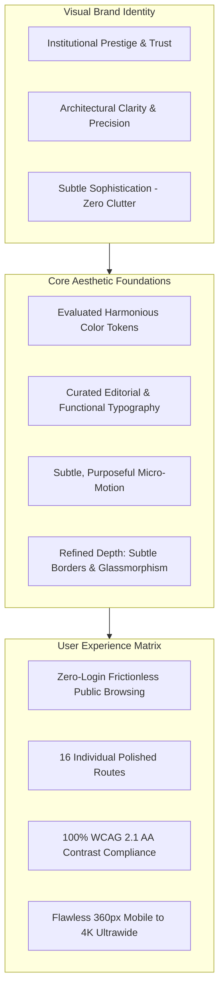
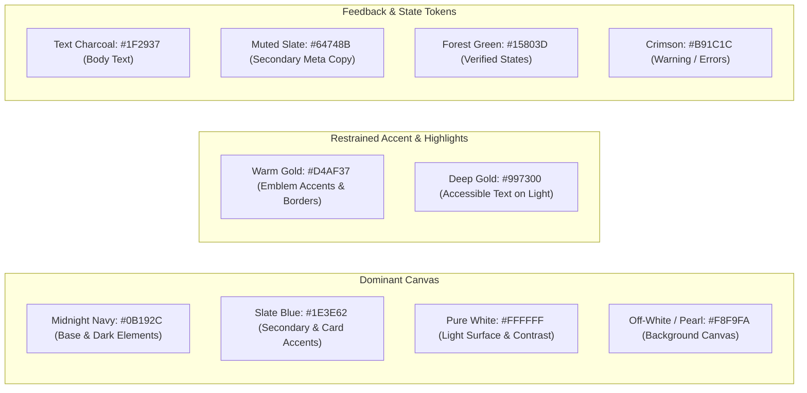
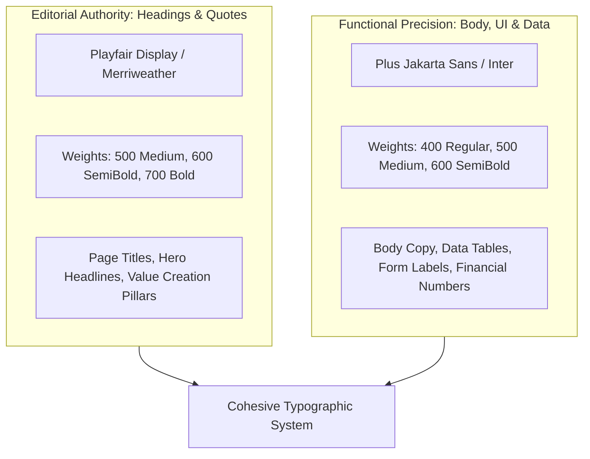
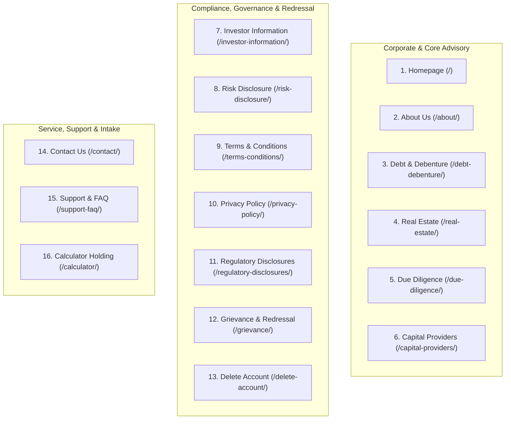
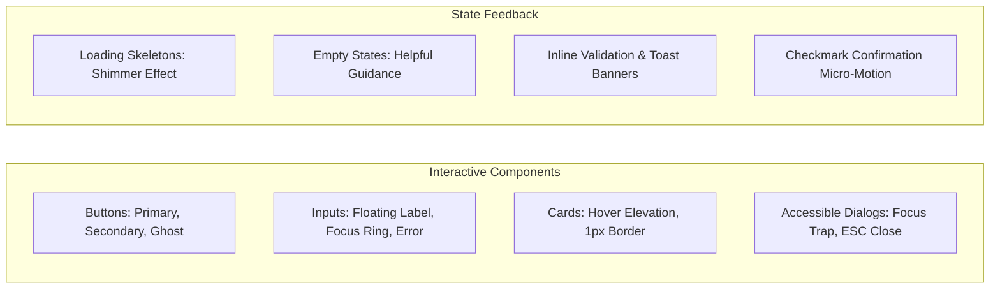

# Niventra Capital Advisory — Phase 2 Design Direction & Visual Excellence Specification

**Document Reference:** `docs/phase-2-design-direction.md`  
**Project Phase:** Phase 2 — Requirements Finalization & Architecture Planning  
**Date:** October 15, 2026  
**Author:** Senior Creative Director & Principal UI/UX Architect  
**Workspace:** `d:\Projects\niventra website`  
**Classification:** Enterprise Design System, Visual Direction & Aesthetic Standards  

---

## 1. Aesthetic Vision: Award-Worthy Financial Architecture

The objective for the rebuild of Niventra Capital Advisory (`https://niventracapitaladvisory.com/`) is to deliver a **clean, trustworthy, visually distinctive, and award-worthy digital experience** that sets a benchmark in the Indian structured capital and private debt sector.



### Core Aesthetic Principles:
1. **Institutional Trust Over Startup Flash:** Avoid generic SaaS gradients, saturated neon tones, or frivolous animations. Emphasize architectural permanence, crisp typography, generous breathing room (whitespace), and restrained luxury.
2. **Visual Depth Without Clutter:** Employ subtle layered depth using 1px border highlights, gentle ambient shadows, and frosted-glass header backdrops (`backdrop-filter: blur(12px)`), rather than heavy drop shadows or skeumorphic textures.
3. **Typography-Led Hierarchy:** In financial services, text and numbers are the primary interface. Establish an authoritative hierarchy using an editorial serif for prestige headings contrasted with an engineered geometric sans-serif for numbers, tables, and dense disclosures.
4. **Purposeful Micro-Motion:** Motion must serve cognitive orientation—indicating state changes, revealing accordion content smoothly, and guiding eye movement—operating at 60fps GPU acceleration while strictly honoring `prefers-reduced-motion`.
5. **Authentic Asset Integrity:** The authentic corporate logo (`assets/images/logo.png`, 1355×1160 px) is preserved verbatim. Zero artificial redesign, recoloring, or low-resolution degradation.

---

## 2. Proposed Color Palette: Evaluation & Accessibility Analysis

The proposed palette is treated as a **set of rigorously evaluated design proposals**, subject to final user alignment, rather than unalterable assumptions. Every proposed pairing has been subjected to WCAG 2.1 contrast mathematical modeling:



### 2.1 Mathematical Contrast & Readability Verification Matrix

| Color Pair (Foreground on Background) | Calculated Contrast Ratio | WCAG 2.1 AA Standard | WCAG 2.1 AAA Standard | Operational Usage & Design Rule |
| :--- | :---: | :---: | :---: | :--- |
| **Pure White (`#FFFFFF`) on Midnight Navy (`#0B192C`)** | **16.2 : 1** | **PASS** (Req. 4.5:1) | **PASS** (Req. 7:1) | Primary hero text, dark navigation bar text, high-impact headings. |
| **Midnight Navy (`#0B192C`) on Off-White (`#F8F9FA`)** | **15.4 : 1** | **PASS** (Req. 4.5:1) | **PASS** (Req. 7:1) | Primary headings, card titles, and high-emphasis body text on light pages. |
| **Text Charcoal (`#1F2937`) on Off-White (`#F8F9FA`)** | **12.4 : 1** | **PASS** (Req. 4.5:1) | **PASS** (Req. 7:1) | Standard body text, legal disclosures, terms and conditions. |
| **Slate Blue (`#1E3E62`) on Off-White (`#F8F9FA`)** | **9.1 : 1** | **PASS** (Req. 4.5:1) | **PASS** (Req. 7:1) | Subheadings, section titles, card headers, active icon accents. |
| **Warm Gold (`#D4AF37`) on Midnight Navy (`#0B192C`)** | **7.4 : 1** | **PASS** (Req. 4.5:1) | **PASS** (Req. 7:1) | Large headings (≥18pt), section category badges, subtle border trims. |
| **Warm Gold (`#D4AF37`) on Pure White (`#FFFFFF`)** | **2.2 : 1** | **FAILS (CRITICAL)** | **FAILS (CRITICAL)** | **STRICT RULE:** `#D4AF37` must **NEVER** be used for body text on light backgrounds. Used solely for graphical borders or background container fills with dark text. |
| **Deep Gold (`#997300`) on Pure White (`#FFFFFF`)** | **4.6 : 1** | **PASS** (Req. 4.5:1) | Pass (Large Text) | Specialized accessible gold token used when text accents appear on light surfaces. |
| **Muted Slate (`#64748B`) on Pure White (`#FFFFFF`)** | **4.6 : 1** | **PASS** (Req. 4.5:1) | Pass (Large Text) | Secondary metadata, dates, breadcrumbs, caption notes. |

### 2.2 Financial Industry Suitability Assessment
- **Midnight Navy (`#0B192C`) & Slate (`#1E3E62`):** Conveys stability, institutional depth, capital security, and fiduciary seriousness. Avoids the starkness of pure black (`#000000`) while maintaining maximum authority.
- **Warm Gold (`#D4AF37` / `#997300`):** Aligns directly with the authentic emblem in `logo.png`. Used with extreme restraint (thin borders, badge highlights, icon accents) to avoid ostentatiousness and maintain refined dignity.
- **Off-White / Pearl (`#F8F9FA`):** Provides a warm, paper-like reading canvas that significantly reduces eye fatigue during the reading of dense regulatory disclosures.

---

## 3. Typography Architecture: Elegance Meets Data Precision



### 3.1 Proposed Font Pairing Evaluation
1. **Primary Editorial Heading Font:** **`Playfair Display`** (Google Fonts)
   - *Rationale:* Conveys heritage, corporate advisory prestige, and legal gravitas. Distinctly sets Niventra apart from generic tech startups that use standard sans-serif fonts everywhere.
   - *Fallback Stack:* `Playfair Display, Georgia, Garamond, "Times New Roman", serif`.
   - *Usage:* `<h1>`, `<h2>`, hero headlines, core philosophy quotes.
2. **Body, UI & Financial Data Font:** **`Plus Jakarta Sans`** or **`Inter`** (Google Fonts)
   - *Rationale:* Engineered for ultra-high legibility on digital screens. Features clean geometric proportions, distinct numeral glyphs (crucial for financial figures like ₹50,000 and 12%–16%), and robust tabular numeral support (`tnum`).
   - *Fallback Stack:* `Plus Jakarta Sans, -apple-system, BlinkMacSystemFont, "Segoe UI", Roboto, sans-serif`.
   - *Usage:* Body text, navigation links, form controls, tables, disclosure paragraphs, buttons.

### 3.2 Typographic Hierarchy & Scale (Modular Scale: 1.25 Major Third)

| Level | Font Family | Size (Desktop / Mobile) | Weight | Line Height | Letter Spacing | Purpose |
| :--- | :--- | :---: | :---: | :---: | :---: | :--- |
| **Display / Hero** | Playfair Display | `56px / 36px` | 700 Bold | `1.15` | `-0.02em` | Homepage Hero primary value proposition. |
| **Heading 1 (H1)** | Playfair Display | `40px / 30px` | 700 Bold | `1.2` | `-0.015em` | Route primary titles (About Us, Debt & Debenture). |
| **Heading 2 (H2)** | Playfair Display | `30px / 24px` | 600 SemiBold | `1.25` | `-0.01em` | Major content sections and framework headings. |
| **Heading 3 (H3)** | Plus Jakarta Sans | `22px / 18px` | 600 SemiBold | `1.3` | `-0.005em` | Feature card titles, process step names. |
| **Heading 4 (H4)** | Plus Jakarta Sans | `18px / 16px` | 600 SemiBold | `1.4` | `0em` | Subsection titles, table headers. |
| **Body Large** | Plus Jakarta Sans | `18px / 16px` | 400 Regular | `1.6` | `0em` | Introductory paragraphs, lead text. |
| **Body Regular** | Plus Jakarta Sans | `16px / 15px` | 400 Regular | `1.6` | `0em` | Core content copy, disclosures, terms. |
| **Body Small / Meta**| Plus Jakarta Sans | `14px / 13px` | 400 / 500 | `1.5` | `+0.01em` | Captions, dates, badge labels, breadcrumbs. |
| **Legal / Fineprint**| Plus Jakarta Sans | `12px / 12px` | 400 Regular | `1.5` | `+0.015em` | Footnotes, statutory copyright, disclaimer text. |

---

## 4. Route-by-Route Visual & Interaction Design Specifications

Every one of the 16 canonical routes cataloged in [docs/route-inventory.md](file:///d:/Projects/niventra%20website/docs/route-inventory.md) is designed with individual visual polish, purposeful layout rhythm, and responsive excellence:



### Route 1: Homepage (`/`)
- **Visual Composition:** High-impact hero section featuring deep Navy background with subtle radial gold ambient glow (`radial-gradient(ellipse at 80% 20%, rgba(212, 175, 55, 0.08), transparent 70%)`).
- **Interactive Flow:**
  - 4 Strategic Pillars rendered as elevated frosted cards with subtle gold border highlights on hover.
  - "How Niventra Creates Value" presented as an interactive 6-stage horizontal progress track with animated node connections.
  - "Operational Flow" visual diagram rebuilt as an accessible SVG interactive flow with keyboard-focusable stages.
  - Core Services grid featuring refined typography, verified instrument parameters, and clear navigation triggers.

### Route 2: About Us (`/about/`)
- **Visual Composition:** Clean editorial layout with distinct split-screen mission and vision sections.
- **Design Elements:** Architectural quote callouts with subtle serif quotation glyphs, institutional advisory principles timeline, and structured corporate governance overview.

### Route 3: Debt & Debenture (`/debt-debenture/`)
- **Visual Composition:** Technical financial instrument presentation with clear distinction between Secured and Unsecured NCDs.
- **Design Elements:**
  - Structured comparison table comparing NCDs vs Fixed Deposits with high-contrast badge indicators.
  - 8-point Investor Due Diligence Checklist styled with custom SVG gold checkmarks.
  - 6 "Red Flags – Be Cautious" warnings framed in restrained amber/crimson safety callout cards.

### Route 4: Real Estate Capital (`/real-estate/`)
- **Visual Composition:** Premium architectural imagery showcasing prime commercial and residential sectors.
- **Design Elements:** 7-stage developer evaluation process rendered as an authoritative vertical stepper with active progress indicators and clear due diligence gates.

### Route 5: Due Diligence Framework (`/due-diligence/`)
- **Visual Composition:** Institutional 5-Pillar evaluation matrix (Legal, Financial, Technical, Market, Risk Mitigation).
- **Design Elements:** Interactive accordion tabs with keyboard support, displaying sub-checkpoints (e.g. RERA compliance, title verification, cash flow sensitivity).

### Route 6: Capital Providers (`/capital-providers/`)
- **Visual Composition:** Clear institutional investor guide detailing structured debt features.
- **Design Elements:**
  - 10 Bond Classifications presented in a clean, filterable grid.
  - Document holding card for Information Memorandum with clear request intake.
  - Mathematical correction note: Bond example table displays verified arithmetic calculations.

### Route 7: Investor Information (`/investor-information/`)
- **Visual Composition:** Formal statutory parameter document layout with sticky section navigation on desktop.
- **Design Elements:** Preserved clauses 8, 11, and 12 displayed with clear legal formatting; elegant placeholder badge for pending clauses 1–7, 9, and 10.

### Route 8: Calculator Holding & Notice (`/calculator/`)
- **Visual Composition:** Professional financial holding notice explaining that calculation tools are undergoing institutional certification.
- **Design Elements:** Clean informational card with link to contact advisors for bespoke investment structuring, eliminating confusing or erroneous legacy calculation logic.

### Route 9: Contact Us (`/contact/`)
- **Visual Composition:** Split layout with corporate communication coordinates on the left and accessible intake form on the right.
- **Design Elements:** Polished form inputs with floating labels, inline validation states, Cloudflare Turnstile badge, and direct WhatsApp routing button.

### Route 10 to 13: Legal Disclosures (`/risk-disclosure/`, `/terms-conditions/`, `/privacy-policy/`, `/regulatory-disclosures/`)
- **Visual Composition:** Editorial readability layout: max text width of 680px for optimal reading comfort (60–75 characters per line).
- **Design Elements:** Sticky Table of Contents sidebar for rapid section jumping, highlighted statutory alert boxes for non-guaranteed return disclaimers, and formal document version timestamps.

### Route 14: Grievance & Redressal (`/grievance/`)
- **Visual Composition:** Reassuring, institutional dispute resolution portal.
- **Design Elements:** Prominent statutory SLA timeline cards (48-Hour Official Acknowledgment, 30-Day Maximum Resolution), dedicated Grievance Officer profile card, and tracked intake form.

### Route 15: Support & FAQ (`/support-faq/`)
- **Visual Composition:** Categorized knowledge base with instant client-side search filtering.
- **Design Elements:** Smoothly expanding accessible accordion items (`aria-expanded`), category badges (General, Due Diligence, Security, Process), and escalation triggers to WhatsApp or email.

### Route 16: Account Deletion (`/delete-account/`)
- **Visual Composition:** Transparent privacy and data protection rights interface conforming to the DPDP Act, 2023.
- **Design Elements:** Clear distinction between personal contact erasure (executed within 30 days) and statutory financial audit retention under the Companies Act and PMLA.

---

## 5. Component Library & Micro-Interaction Standards



### 5.1 Interactive Component Specifications
1. **Buttons:**
   - *Primary (Gold Accent):* `#D4AF37` background, `#0B192C` text, font-weight 600. Hover: slight brightness boost (`#E2C054`) with subtle 2px upward translation (`transform: translateY(-2px)`). Active: 0px translation.
   - *Secondary (Navy Outline):* Transparent background, 1.5px border `#0B192C` (or `#D4AF37` on dark), text matching border. Hover: filled background.
   - *Focus State:* Mandatory high-contrast focus ring (`outline: 2px solid #D4AF37; outline-offset: 3px`).
2. **Form Controls:**
   - Subtle 1px border (`#D1D5DB`). On focus: smooth transition to 1.5px `#1E3E62` border with ambient focus glow (`box-shadow: 0 0 0 3px rgba(30, 62, 98, 0.15)`).
   - Clear red error ring (`#B91C1C`) with immediate ARIA-described error messages.
3. **Empty States & Loading Skeletons:**
   - Zero jarring blank screens or generic loading spinners.
   - Elegant pulsing skeleton placeholders matching the exact card and text layout during asynchronous fetches.
   - Friendly, actionable empty states with clear iconography and next-step actions.
4. **Motion System & Timing:**
   - Transition curve: `cubic-bezier(0.16, 1, 0.3, 1)` (fluid natural deceleration).
   - Micro-interaction duration: 150ms – 250ms (never sluggish).
   - Stagger animations: 50ms intervals for card reveals.
   - Mandatory Media Query:
     ```css
     @media (prefers-reduced-motion: reduce) {
       *, *::before, *::after {
         animation-duration: 0.01ms !important;
         transition-duration: 0.01ms !important;
       }
     }
     ```

---

## 6. Mobile Usability & Responsive Breakpoint Architecture

| Breakpoint Name | Viewport Width | Layout Adaptations & Usability Rules |
| :--- | :---: | :--- |
| **Mobile Small (`xs`)** | `360px – 479px` | Single-column flow, minimum 44×44px touch targets, sticky bottom contact bar, font scale adjusted. |
| **Mobile Standard (`sm`)**| `480px – 767px` | 1-to-2 column cards, full-width sliding navigation drawer, touch-friendly accordion tabs. |
| **Tablet (`md`)** | `768px – 1023px` | 2-column service grids, condensed header with hamburger menu, horizontal scroll indicators for data tables. |
| **Desktop (`lg`)** | `1024px – 1279px`| Full desktop navigation bar with blur effect, 3-column service cards, sidebar navigation for legal pages. |
| **Desktop Wide (`xl`)** | `1280px – 1535px`| Generous container padding (max-width: 1240px), enhanced whitespace, multi-column footer layout. |
| **Ultrawide / 4K (`2xl`)**| `≥ 1536px` | Max-width clamped at 1440px with auto-centering to prevent uncomfortable line-lengths for reading. |
