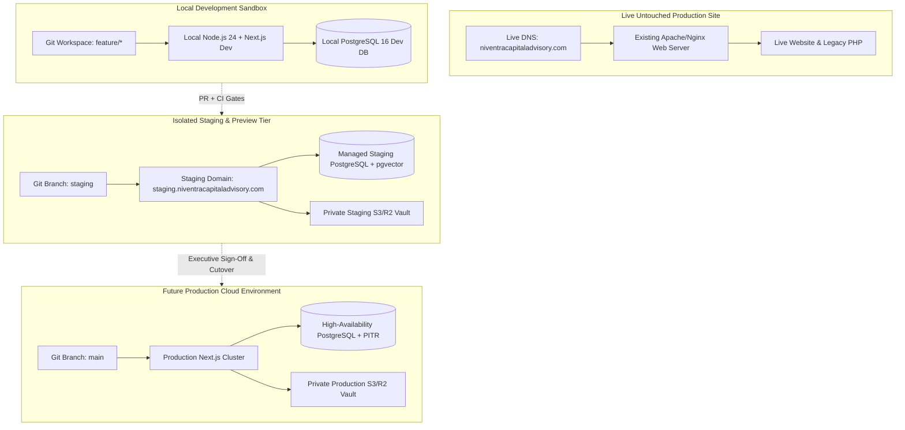
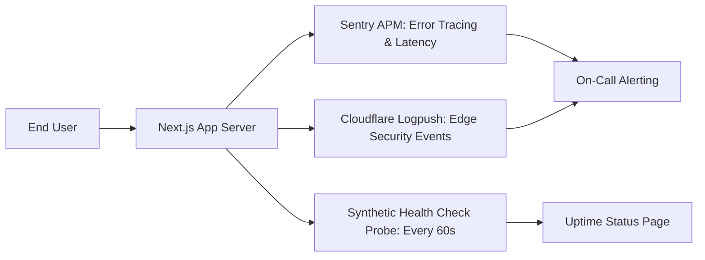
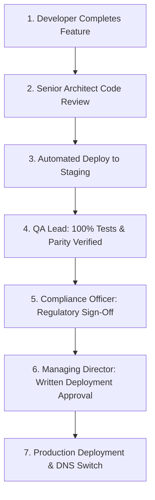

# Niventra Capital Advisory — Phase 2 Environment, Staging & Deployment Plan

**Document Reference:** `docs/phase-2-environment-plan.md`  
**Project Phase:** Phase 2 — Requirements Finalization & Architecture Planning  
**Date:** October 15, 2026  
**Author:** Senior DevOps & Cloud Infrastructure Architect  
**Workspace:** `d:\Projects\niventra website`  
**Classification:** Infrastructure, Environment Isolation & Deployment Runbook  

---

## 1. Environmental Isolation & Live System Protection

Operating within a live corporate financial advisory context requires an absolute guarantee that existing business operations remain uninterrupted.

### Core Environmental Safeguards:
1. **Absolute Live Website Isolation:** The live production website (`https://niventracapitaladvisory.com/`) will remain 100% untouched throughout all development, testing, and staging phases. Zero DNS records, server configurations, or live files will be altered until the final authorized cutover in Phase 10.
2. **Strict Three-Tier Environment Separation:**
   - **Local Development:** Developers execute code locally on private machines (`localhost:3000`) with mock environment variables and seeded test databases.
   - **Staging / Preview:** Hosted on an isolated password-protected or IP-restricted subdomain (`staging.niventracapitaladvisory.com` or Vercel Preview) utilizing dedicated staging databases and sandbox payment gateways.
   - **Future Production:** Hardened, high-availability cloud infrastructure provisioned in an isolated production VPC with automated daily backups and restricted compliance access.
3. **Zero Contamination of Production Data:** Test transactions, dummy user profiles, and QA tests are strictly prohibited in the production environment.

---

## 2. Version Control Strategy & Branch Protection

### 2.1 Branching Topology
- **`main` (Production Branch):** Reflects the current production release state. Direct commits, pushes, and force pushes are strictly disabled. Only merges from `staging` via approved pull requests are permitted.
- **`staging` (Integration Branch):** Hosts the code deployed to the staging environment for QA testing, UAT, and stakeholder review.
- **`feature/<ticket-description>`:** Short-lived feature branches branched off `staging`.
- **`hotfix/<issue-description>`:** Emergency branches branched off `main` for critical production bug fixes.

### 2.2 Branch Protection Rules (Enforced via GitHub / GitLab)
1. **Mandatory Pull Requests:** Every change must be submitted as a pull request.
2. **Mandatory Peer Reviews:** Minimum of 1 senior architect review and approval required.
3. **Automated CI Quality Gate Enforcement:** All 6 CI gates (TypeScript compilation, ESLint, Vitest unit tests, Playwright E2E tests, axe-core a11y, and Lighthouse CI) must pass with zero errors.
4. **Linear Git History:** Squash and merge or rebase merge enforced to maintain clean auditability.
5. **Signed Commits:** Cryptographic GPG commit signing enforced for all code contributions.

---

## 3. Configuration & Secret Management Architecture

### 3.1 Secret Storage & Boundary Rules
- **Rule 1 (Zero Secrets in Git):** Files matching `.env*` (except `.env.example`) are permanently excluded in `.gitignore`. Pre-commit hooks scan for accidental secret leakage using `gitleaks`.
- **Rule 2 (Client Bundle Isolation):** Only environment variables prefixed with `NEXT_PUBLIC_` are exposed to client-side JavaScript. All database connection strings, encryption keys, LLM API keys, and email credentials must strictly omit the prefix.
- **Rule 3 (Platform Secret Storage):** Staging and production secrets reside exclusively within the hosting platform's encrypted secret store (Vercel Project Settings / AWS Secrets Manager) and are injected at runtime.

### 3.2 Environment Variable Matrix

| Variable Name | Exposure | Staging Value | Production Value | Purpose |
| :--- | :--- | :--- | :--- | :--- |
| `NODE_ENV` | Server | `production` | `production` | Node runtime optimization |
| `NEXT_PUBLIC_APP_URL` | Public | `https://staging.niventra...` | `https://niventracapitaladvisory.com` | Base URL for metadata & links |
| `DATABASE_URL` | Server | Managed PostgreSQL Staging URL | Managed PostgreSQL Production URL | Database connection string |
| `SESSION_SECRET` | Server | 64-char random hex string | 64-char cryptographically secure key | Cookie session encryption key |
| `AI_SERVICE_KEY` | Server | Sandbox LLM API Key | Production Metered LLM Key | Server-side RAG inference key |
| `OBJECT_STORAGE_BUCKET` | Server | `niventra-staging-vault` | `niventra-prod-vault` | Private S3 / R2 document bucket |
| `OBJECT_STORAGE_SECRET` | Server | Staging IAM Key | Production Dedicated IAM Key | Object storage credentials |
| `RESEND_API_KEY` | Server | Sandbox Email API Key | Dedicated Production Email Key | Transactional email service |
| `CLOUDFLARE_TURNSTILE_SECRET`| Server | Cloudflare Always-Pass Test Key| Production Turnstile Secret Key | Bot defense server verification |
| `NEXT_PUBLIC_TURNSTILE_KEY` | Public | Cloudflare Always-Pass Site Key| Production Turnstile Site Key | Client-side bot defense widget |

---

## 4. Asset Baseline & Content Parity Management

### 4.1 Asset Integrity Preservation
- The authentic, original high-resolution logo (`assets/images/logo.png`, 1355×1160 pixels, 671.6 KB) stored in [preserved-assets/assets/images/logo.png](file:///d:/Projects/niventra%20website/preserved-assets/assets/images/logo.png) is designated as the immutable source asset.
- Brand graphic assets (`bond-plant.png`, `premium_corporate_real_estate.png`, `privacy_lock.png`, `terms_agreement.png`) are cataloged and preserved in their authentic binary forms.
- An automated asset integrity check verifies SHA-256 checksums on all static image assets during the build step.

### 4.2 Content Inventory Synchronization
- Content updates must adhere strictly to the cataloged inventory in [docs/content-inventory.csv](file:///d:/Projects/niventra%20website/docs/content-inventory.csv).
- Any discrepancy between rendered page text and the baseline triggers an immediate notification in CI/CD.

---

## 5. Backup, Disaster Recovery & High Availability

### 5.1 Database Recovery Objectives
- **Recovery Point Objective (RPO):** < 15 minutes (maximum permissible data loss window).
- **Recovery Time Objective (RTO):** < 60 minutes (maximum permissible system restoration time).

### 5.2 Backup Automation Plan
1. **Automated Daily Snapshots:** Cloud-managed PostgreSQL creates automated full backups every 24 hours at 02:00 IST.
2. **Point-In-Time-Recovery (PITR):** Write-Ahead Logging (WAL) continuously streams to off-site cloud storage, allowing database restoration to any specific second within a 30-day rolling window.
3. **Object Storage Versioning:** Private document buckets (S3 / Cloudflare R2) have Object Versioning enabled with 90-day delete markers, preventing accidental or malicious document deletion.
4. **Bi-Annual Disaster Recovery Drills:** The engineering team executes simulated disaster recovery restorations to a sandbox environment every six months.

---

## 6. Monitoring, Observability & Error Tracking

1. **Error Tracking (Sentry):**
   - Real-time client-side and server-side exception logging.
   - PII scrubbing enabled: All user passwords, PAN numbers, and personal identifiers are stripped from crash stack traces.
2. **Synthetic Health Checks:**
   - External monitoring probe (e.g., BetterStack / Pingdom) hits `/api/health` every 60 seconds from multiple global regions.
   - Database ping, vector store connectivity, and storage vault health evaluated.
3. **Edge Analytics & WAF Monitoring:**
   - Cloudflare analytics tracking request volumes, blocked DDoS attempts, and bot challenges.

---

## 7. Deployment Approval Workflow & Production Cutover Runbook

### 7.1 Formal Change Management Gates
Before code can progress through environments, explicit sign-offs are documented:

### 7.2 Zero-Downtime Production Cutover Runbook (Phase 10)
When executive authorization is granted for final deployment:
1. **T-7 Days (Pre-Cutover Preparation):** Lower DNS Time-to-Live (TTL) on `niventracapitaladvisory.com` from 86,400s (24h) to 300s (5 minutes) in Cloudflare DNS.
2. **T-24 Hours (Final Rehearsal):** Execute a complete dry-run deployment to the staging environment; run the full Playwright E2E and content parity verification suite.
3. **T-2 Hours (Production Provisioning):** Provision production cloud database and apply latest Prisma migrations. Seed authorized product catalogue and verified offering documents.
4. **T-0 (Cutover Execution):**
   - Update Cloudflare DNS records: Point apex `@` and `www` CNAME to the new production Next.js cluster.
   - Cloudflare SSL/TLS mode set to `Full (Strict)` with TLS 1.3 minimum.
   - Verify that all 16 canonical routes resolve to the new application with HTTP 200.
5. **T+15 Minutes (Smoke Verification):**
   - Execute live synthetic smoke tests: Verify header, logo rendering, contact form submission, grievance ticket generation, and document watermarking.
   - Verify security headers via securityheaders.com (Target: Grade A+).
6. **Rollback Contingency Plan:** If any critical defect or regulatory block occurs within the 2-hour post-launch window, immediately revert Cloudflare DNS A-record to the legacy Apache/Nginx IP. The legacy site remains warm and active for 14 days post-cutover as an instant rollback safeguard.
