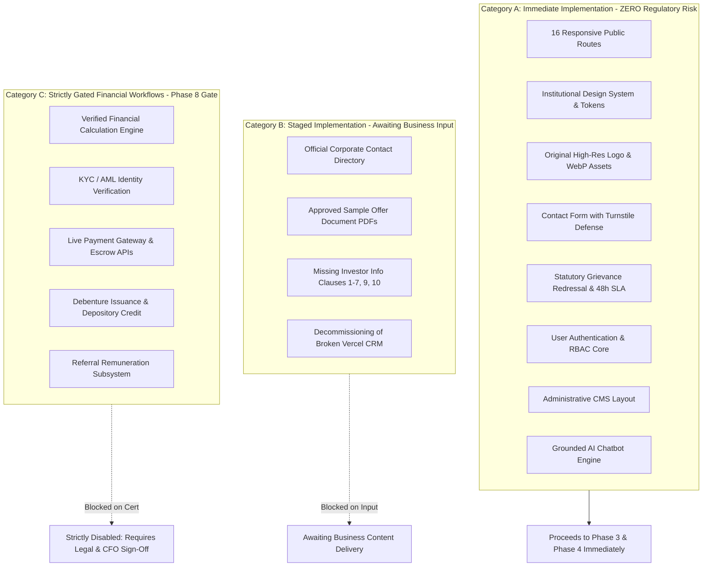
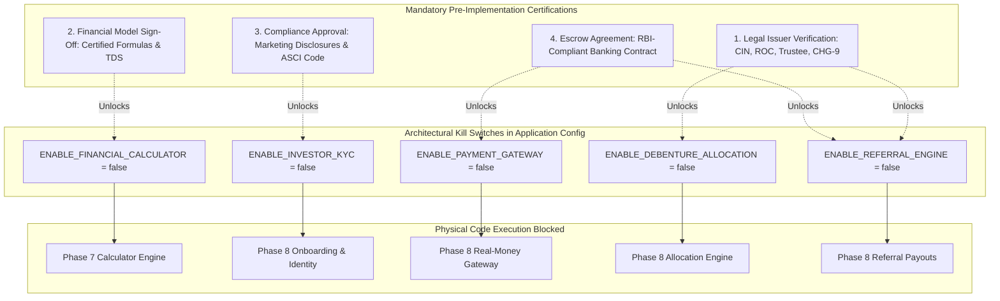

# Niventra Capital Advisory — Phase 2 Feature Dependencies & Implementation Boundaries

**Document Reference:** `docs/phase-2-feature-dependencies.md`  
**Project Phase:** Phase 2 — Requirements Finalization & Architecture Planning  
**Date:** October 15, 2026  
**Author:** Senior Technical Program Manager & Lead Systems Architect  
**Workspace:** `d:\Projects\niventra website`  
**Classification:** Enterprise Requirements Traceability & Feature Boundary Matrix  

---

## 1. Executive Implementation Boundaries

To ensure rapid engineering progress on safe, foundational components while safeguarding the enterprise against regulatory liabilities, all platform capabilities are partitioned into three rigorous operational categories:



### Core Categorization Rules:
- **Category A (Ready for Development):** Structural, visual, informational, and security foundations that can proceed immediately into Phase 3 engineering upon Phase 2 approval.
- **Category B (Awaiting Content / Direction):** Informational elements where temporary verified holding structures are deployed while awaiting final corporate assets from company leadership.
- **Category C (Strictly Gated Financial Workflows):** Transactional, real-money, issuance, and calculation features that **must remain programmatically disabled** until independent legal, compliance, and banking certifications are executed.

---

## 2. Comprehensive Feature Dependency Matrix

| Feature ID | Feature Name | Category | Status | Technical Dependencies | Governance / Business Prerequisite | Designated Approver |
| :--- | :--- | :---: | :---: | :--- | :--- | :--- |
| **FEAT-01** | Public Informational Routes (16 Pages) | **A** | **Ready** | Next.js 15 App Router, TypeScript, TailwindCSS | None (Full content preserved from Phase 1) | QA Lead |
| **FEAT-02** | Institutional Design System & Tokens | **A** | **Ready** | TailwindCSS, CSS Variables, Google Fonts | Approved brand guidelines | Lead Designer |
| **FEAT-03** | Authentic Brand Asset Integration | **A** | **Ready** | Local `preserved-assets/` directory | None (Original `logo.png` preserved) | QA Lead |
| **FEAT-04** | Server-Side Contact Intake Form | **A** | **Ready** | Next.js Server Actions, Zod, Turnstile | Cloudflare Turnstile Site/Secret Keys | Technical Architect |
| **FEAT-05** | Statutory Grievance Redressal Engine | **A** | **Ready** | PostgreSQL, Prisma, Email Gateway | None (Statutory 48h/30d policy established) | Compliance Officer |
| **FEAT-06** | User Authentication & RBAC Core | **A** | **Ready** | Argon2id, iron-session, PostgreSQL | None (Self-hosted security architecture) | Security Architect |
| **FEAT-07** | Administrative Lead Console | **A** | **Ready** | React Server Components, TailwindCSS | FEAT-06 (RBAC Authentication) | Lead Architect |
| **FEAT-08** | Grounded AI Knowledge Assistant | **A** | **Ready** | PostgreSQL `pgvector`, Server LLM API | Approved public copy corpus | Technical Architect |
| **FEAT-09** | Official Contact Directory Update | **B** | **Staged** | Global footer & contact page templates | Company-approved contact directory ([DEC-03](file:///d:/Projects/niventra%20website/docs/decision-register.md#dec-03)) | Head of Marketing |
| **FEAT-10** | Downloadable Sample Offer PDFs | **B** | **Staged** | Secure S3 Document Vault, signed URLs | Delivery of approved sample PDFs ([DEC-04](file:///d:/Projects/niventra%20website/docs/decision-register.md#dec-04)) | Corporate Secretary |
| **FEAT-11** | Investor Information Complete Policy | **B** | **Staged** | `/investor-information/` page template | Provision of clauses 1–7, 9, 10 ([DEC-04](file:///d:/Projects/niventra%20website/docs/decision-register.md#dec-04)) | General Counsel |
| **FEAT-12** | Decommissioning of Broken Vercel CRM | **B** | **Staged** | Removal of dead link from `/capital-providers/`| Formal admin sign-off ([DEC-05](file:///d:/Projects/niventra%20website/docs/decision-register.md#dec-05)) | CISO / Management |
| **FEAT-13** | Verified Financial Calculation Engine | **C** | **Deferred** | Phase 7 Calculator Module | CFO mathematical sign-off ([DEC-02](file:///d:/Projects/niventra%20website/docs/decision-register.md#dec-02), [DEC-07](file:///d:/Projects/niventra%20website/docs/decision-register.md)) | Chief Financial Officer |
| **FEAT-14** | Investor KYC & AML Verification | **C** | **Gated** | Digio / Signzy API integration | Legal confirmation of issuance structure ([DEC-01](file:///d:/Projects/niventra%20website/docs/decision-register.md#dec-01)) | Chief Compliance Officer |
| **FEAT-15** | Live Payment Gateway & Escrow APIs | **C** | **Gated** | Bank virtual accounts / Razorpay / ICICI | Approved payment provider & escrow contract ([DEC-06](file:///d:/Projects/niventra%20website/docs/decision-register.md#dec-06)) | CFO & Legal Counsel |
| **FEAT-16** | Debenture Allocation & Depository Credit | **C** | **Gated** | Independent allocation ledger | ROC Form CHG-9, Debenture Trustee deed ([DEC-01](file:///d:/Projects/niventra%20website/docs/decision-register.md#dec-01)) | Board & General Counsel |
| **FEAT-17** | Referral Reward Subsystem | **C** | **Gated** | Referral ledger, anti-fraud controls | Companies Act Sec 42 & Sec 194H TDS clearance | Legal & Tax Counsel |

---

## 3. Deep Dive: Gated Financial Workflows (Category C Guardrails)



### 3.1 Architectural Kill Switches (Feature Flags)
All Category C capabilities will be governed by environment-level feature flags in the application codebase (`src/config/features.ts`):
```typescript
// src/config/features.ts
export const FEATURE_FLAGS = {
  // Category A - Public & Operational (Active)
  ENABLE_PUBLIC_PAGES: true,
  ENABLE_CONTACT_FORM: true,
  ENABLE_GRIEVANCE_SLA: true,
  ENABLE_USER_AUTH: true,
  ENABLE_AI_ASSISTANT: true,

  // Category B - Staged Business Elements
  ENABLE_VERIFIED_CONTACTS: process.env.ENABLE_VERIFIED_CONTACTS === 'true',
  ENABLE_OFFER_DOC_DOWNLOADS: process.env.ENABLE_OFFER_DOC_DOWNLOADS === 'true',

  // Category C - Strictly Gated Financial Workflows (HARDCODED FALSE UNTIL FORMAL CERTIFICATION)
  ENABLE_FINANCIAL_CALCULATOR: false, // Deferred to Phase 7
  ENABLE_INVESTOR_KYC: false,         // Gated to Phase 8
  ENABLE_PAYMENT_GATEWAY: false,      // Gated to Phase 8
  ENABLE_DEBENTURE_ALLOCATION: false, // Gated to Phase 8
  ENABLE_REFERRAL_ENGINE: false,      // Gated to Phase 8
} as const;
```

### 3.2 Enforcement in Server Actions and API Routes
Every financial endpoint is guarded by a programmatic assertion:
```typescript
if (!FEATURE_FLAGS.ENABLE_PAYMENT_GATEWAY) {
  throw new Error("Financial transactions are disabled pending regulatory and corporate certification.");
}
```

---

## 4. Blocking Conditions & Stakeholder Action Register

The table below outlines the exact actions and artifacts required from corporate stakeholders to unblock Categories B and C:

| Stakeholder Role | Blocked Feature(s) | Required Action / Artifact | Target Phase Gate |
| :--- | :--- | :--- | :---: |
| **General Counsel / CS** | FEAT-11, FEAT-14, FEAT-16, FEAT-17 | 1. Provide missing clauses 1–7, 9, 10 for `/investor-information/`.<br>2. Certify issuing corporate entity name, CIN, and Section 71/42 private placement structure.<br>3. Confirm Debenture Trustee appointment and Form CHG-9 filings.<br>4. Issue legal clearance on the proposed 1% referral reward under private placement rules. | **Phase 2 / Phase 8 Gate** |
| **Corporate Secretary** | FEAT-10 | Provide official, watermarked sample Information Memorandum and Term Sheet PDFs. | **Phase 2 / Phase 4 Gate** |
| **Chief Compliance Officer**| FEAT-09, FEAT-14 | 1. Sign off on public marketing text regarding the 12%–16% debenture return range.<br>2. Draft mandatory co-located risk disclaimers under SEBI/ASCI guidelines.<br>3. Approve investor KYC/AML verification requirements. | **Phase 2 / Phase 4 Gate** |
| **Chief Financial Officer** | FEAT-13, FEAT-15 | 1. Formally sign off on calculator formulas (compounding, day-count basis, TDS withholding).<br>2. Authorize payment/settlement provider and escrow banking contract. | **Phase 2 / Phase 7 Gate** |
| **Head of Marketing** | FEAT-09 | Provide authoritative company contact directory resolving phone, WhatsApp, and office address. | **Phase 3 Gate** |
| **CISO / Management** | FEAT-12 | Confirm ownership of `crm-teal-one-29.vercel.app` and authorize its permanent decommissioning. | **Phase 3 Gate** |
