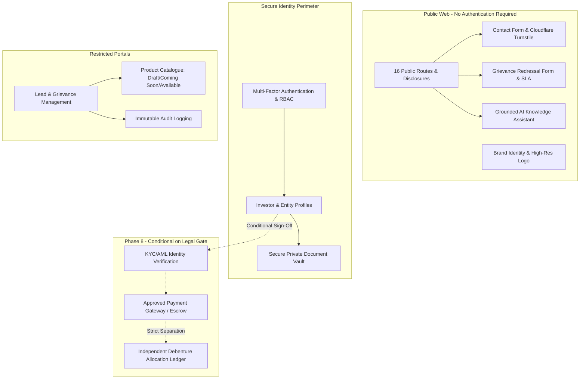

# Niventra Capital Advisory — Phase 2 Requirements Specification

**Document Reference:** `docs/phase-2-requirements.md`  
**Project Phase:** Phase 2 — Requirements Finalization & Architecture Planning  
**Date:** October 15, 2026  
**Author:** Senior Enterprise Software Architect & Financial Systems Auditor  
**Workspace:** `d:\Projects\niventra website`  
**Classification:** Enterprise Requirements Specification & Governance Baseline  

---

## 1. Executive Requirements Confirmation & Core Principles

This document formalizes the complete technical, operational, and regulatory requirements for the enterprise rebuild of the official Niventra Capital Advisory website (`https://niventracapitaladvisory.com/`).

### 1.1 Core Tenets & Baseline Confirmations
1. **Real Financial-Services Enterprise:** Niventra Capital Advisory India Pvt. Ltd. is an active corporate entity in the structured capital and real estate advisory domain. The rebuilt platform is an enterprise-grade financial application requiring institutional reliability, strict data privacy, security defense-in-depth, and regulatory compliance—**not a demo, prototype, or portfolio project**.
2. **Mandatory Content & Route Preservation:** 100% of legitimate existing website copy, corporate disclosures, legal agreements, brand images, and URL paths must be preserved in accordance with [docs/content-parity-checklist.md](file:///d:/Projects/niventra%20website/docs/content-parity-checklist.md) and [docs/route-inventory.md](file:///d:/Projects/niventra%20website/docs/route-inventory.md). Zero silent omissions are permitted.
3. **Defect & Inconsistency Filtering:** The live website contains verified technical bugs, arithmetic errors, dead download links, and encoding corruptions (documented in [docs/website-audit.md](file:///d:/Projects/niventra%20website/docs/website-audit.md)). **Incorrect content, invalid calculations, and broken links must NOT automatically be carried over into the rebuilt platform.**
4. **Intended Debenture Return Range (12%–16%):** As confirmed in Phase 1.2 ([docs/decision-register.md#dec-02](file:///d:/Projects/niventra%20website/docs/decision-register.md)), debenture returns are currently understood to fall within a preliminary business guidance range of **12% – 16%**. This figure is cataloged as preliminary guidance, not as an approved contractual coupon, audited yield, or guaranteed return. Existing live website text (advertising 14%–16%) is retained in baseline parity records, and no public copy will be modified without written approval of final wording and co-located risk disclaimers by compliance counsel.
5. **Issuer Identity & Regulatory Gating:** As confirmed in Phase 1.2 ([docs/decision-register.md#dec-01](file:///d:/Projects/niventra%20website/docs/decision-register.md)), Niventra Capital Advisory itself is intended to be the legal issuer of the initial debenture product. While establishing architectural scope, this business intent is strictly separated from independent legal verification. Prior to activating any investor onboarding, payment processing, or debenture allocation, company legal/compliance counsel must independently verify the exact issuing corporate entity, Corporate Identification Number (CIN), registered office, and statutory private placement compliance under Companies Act, 2013 (Section 71, Section 42, and PAS-4 / CHG-9 filings). No registration numbers or licenses are assumed or fabricated.
6. **Public Website Open Accessibility:** **Public website functionality must NOT require visitors to log in.** All corporate overviews, educational guides, service descriptions, regulatory disclosures, risk factors, grievance mechanisms, and contact channels must remain immediately accessible without registration or authentication.
7. **Calculator Deferral:** Due to compound defects, conflicting mathematical models, and the lack of certified product terms, **reconstruction and implementation of financial calculators is formally DEFERRED** to a later phase (Phase 7), pending CFO sign-off on underlying formulas.

---

## 2. Detailed Functional Requirements by Module



### Module 1: Public Website & Content Presentation
- **FR-1.1 Route Preservation:** Maintain all 16 canonical public routes exactly as documented in [docs/route-inventory.md](file:///d:/Projects/niventra%20website/docs/route-inventory.md), supporting trailing slashes without redirect degradation.
- **FR-1.2 Asset Fidelity:** Render the authentic corporate logo (`assets/images/logo.png`, 1355×1160 px, Navy `#0B192C` and Gold `#D4AF37`) without recoloring or geometric modification. Convert MIME-mislabelled JPEG brand graphics (`bond-plant.png`, `premium_corporate_real_estate.png`, etc.) to modern WebP format while preserving visual fidelity.
- **FR-1.3 Encoding Hygiene:** Restore all corrupted UTF-8 mojibake strings to pristine Unicode glyphs (`₹` -> `₹`, `©` -> `©`, `–` -> `–`).
- **FR-1.4 Public Information Architecture:** Deliver clear, responsive views across desktop, tablet, and mobile for:
  - Homepage (`/`) with 6-stage value creation lifecycle and 9-node operational workflow.
  - Corporate mission, vision, and institutional advisory approach (`/about/`).
  - Structured debt instruments, NCD classification, and due diligence checklist (`/debt-debenture/`).
  - Real estate asset categories and 7-stage developer evaluation process (`/real-estate/`).
  - 5-point due diligence framework (`/due-diligence/`).
  - Instrument highlights and bond education guide (`/capital-providers/`).
  - Complete statutory risk disclosures, platform terms, privacy policy, and regulatory declarations.
- **FR-1.5 Visual Excellence & Quality Gate Adherence:** Public pages must adhere strictly to the institutional aesthetic, evaluated typography, and contrast standards documented in [docs/phase-2-design-direction.md](file:///d:/Projects/niventra%20website/docs/phase-2-design-direction.md), and must satisfy all 10 measurable quality gates codified in [docs/phase-2-visual-quality-gates.md](file:///d:/Projects/niventra%20website/docs/phase-2-visual-quality-gates.md).
- **FR-1.6 Mandatory Installed Skill Inspection:** Antigravity must inspect and read the actual instructions of relevant installed skills (`antigravity_guide`, `agy-customizations`, `permissioned-github`) prior to performing corresponding development tasks, logging the specific instruction followed and verification check completed.

### Module 2: User Authentication, Authorization & Profiles
- **FR-2.1 Non-Intrusive Access:** Browsing public pages requires zero authentication. Authentication is strictly required only to enter the Investor Dashboard or Administrative CMS.
- **FR-2.2 Multi-Factor Authentication (MFA):** Support email magic link or time-based one-time password (TOTP) MFA for investor and administrative logins.
- **FR-2.3 Role-Based Access Control (RBAC):** Enforce strict privilege separation across four discrete roles:
  - `INVESTOR`: Can view own profile, download approved offering documents, submit application enquiries, and track support tickets.
  - `DEVELOPER`: Real estate partner seeking capital; can view project evaluation status.
  - `ADMIN`: Operational personnel; can manage contact leads, assign grievance tickets, update product catalogue states, and review audit logs.
  - `COMPLIANCE_OFFICER`: Legal/compliance authority; can certify offering documents, review KYC verifications, and inspect immutable audit logs.
- **FR-2.4 Account Management & DPDP Compliance:** Provide user profile management, session termination across devices, and a native Account Deletion workflow conforming to Section 12 of the DPDP Act, 2023, while honoring statutory financial record retention overrides.

### Module 3: Investor & Administrative Dashboards
- **FR-3.1 Investor Portal:**
  - Status overview of submitted enquiries and applications.
  - Document repository to view/download personalized offering memoranda, watermarked term sheets, and counter-signed agreements.
  - Direct communication thread for grievance tracking.
- **FR-3.2 Administrative CMS:**
  - Unified lead intake console for contact enquiries and project proposals.
  - Grievance tracking dashboard with automated SLA timer indicators (48-hour acknowledgment, 30-day resolution).
  - Centralized Document Management Console for uploading verified PDFs, managing version histories, and applying watermarks.

### Module 4: Product Catalogue Management
- **FR-4.1 Debenture & Real Estate Asset Models:** Store structured product metadata (Issuer Entity, Asset Class, Collateral/Security Type, Minimum Subscription, Target Tenure).
- **FR-4.2 Lifecycle State Machine:** Enforce discrete product states:
  - `Draft`: Internal staging only; invisible to public and investors.
  - `Coming Soon`: Publicly listed for awareness; application and payment actions are strictly disabled.
  - `Available`: Active for eligible investor application enquiries (subject to compliance gates).
  - `Suspended`: Temporarily halted by compliance; no new applications accepted.
  - `Closed`: Fully subscribed or matured; historical archive state.
- **FR-4.3 Zero Unapproved Terms:** Products cannot display interest rates or terms that have not been explicitly certified by the CFO and Compliance Officer.

### Module 5: Grounded AI Knowledge Assistant (Chatbot)
- **FR-5.1 Deterministic Grounding:** The chatbot must be grounded exclusively in approved company literature (public website copy, approved FAQs, and authorized offering summaries).
- **FR-5.2 Zero Hallucination Guardrail:** The model must never fabricate returns, interest rates, tax advice, regulatory registration numbers, or legal guarantees. If confidence is below threshold, it must return a standardized fallback: *"I do not have verified company information on that topic. Would you like to connect with our advisory team?"*
- **FR-5.3 Mandatory Citation:** Every factual assertion generated must include clickable source citations to the corresponding public website page or policy.
- **FR-5.4 Security Isolation:** Zero browser exposure of model API keys; all retrieval and generation must execute in server-side API routes with prompt-injection sanitization.

### Module 6: Document Storage, Security & Watermarking
- **FR-6.1 Secure Private Storage:** Offering documents and sensitive attachments must reside in private cloud object storage (e.g., AWS S3 / Cloudflare R2), never in public web roots.
- **FR-6.2 Ephemeral Access:** Document downloads must be served via short-lived, cryptographically signed URLs (validity ≤ 15 minutes).
- **FR-6.3 Dynamic Watermarking:** Downloaded Information Memoranda and Term Sheets should be dynamically stamped with the investor's verified email, timestamp, and a confidentiality disclaimer.

### Module 7: Enquiry, Contact & Grievance Redressal
- **FR-7.1 Secure Contact Intake:** Contact forms must submit via server-side actions protected by Cloudflare Turnstile bot detection, input validation (Zod), and rate limiting.
- **FR-7.2 Statutory Grievance Handling:**
  - Dedicated grievance intake capturing complainant name, email, phone, reference number, and grievance category.
  - Automatic dispatch of an acknowledgment email containing a unique tracking ticket within **48 hours** (per published company policy).
  - Escalation alert to the designated Grievance Redressal Officer if unresolved at **15 days** and **25 days**, enforcing the **30-day resolution SLA**.

### Module 8: Notifications, Communications & Audit Logging
- **FR-8.1 Transactional Email:** Automated dispatch of email notifications via an enterprise provider (SendGrid / Resend) for contact confirmations, grievance tickets, password resets, and document releases.
- **FR-8.2 Immutable Audit Trail:** Log all critical security and data events (logins, failed authentication attempts, role changes, document downloads, product status transitions) in a tamper-resistant PostgreSQL audit table.

---

## 3. Implementation Boundaries (Categories A, B, and C)

To ensure that development progresses rapidly on safe components while strictly protecting the company against premature financial or legal commitments, all features are segmented into three operational categories:

```mermaid
graph LR
    subgraph Category A [Category A: Immediate Implementation]
        A1[Public Responsive Pages]
        A2[Design System & Tokens]
        A3[Original Logo & Asset Pipeline]
        A4[Contact Form with Turnstile]
        A5[Grievance Intake & SLA Engine]
        A6[Grounded AI Chatbot Engine]
        A7[User Auth & RBAC Framework]
        A8[Admin CMS Structure]
    end

    subgraph Category B [Category B: Blocked on Business Input]
        B1[Official Contact Directory]
        B2[Approved Sample Offer PDFs]
        B3[Missing Investor Info Clauses 1-7, 9, 10]
        B4[Decommissioning of Vercel CRM]
    end

    subgraph Category C [Category C: Strictly Gated Financial Features]
        C1[Verified Financial Calculator]
        C2[Real-Money Payment Gateway]
        C3[Escrow & Virtual Account Integration]
        C4[Investor KYC & Demat Verification]
        C5[Debenture Allocation Engine]
        C6[Referral Reward Subsystem]
    end

    Category A -.->|Proceeds Now| Dev[Phase 3 & Phase 4 Development]
    Category B -.->|Awaits Input| RevB[Corporate Management Sign-Off]
    Category C -.->|Awaits Cert| RevC[Legal / CFO / Compliance Gate]
```

### Category A: Public Website & Non-Financial Functionality (Proceed Immediately)
These features possess zero regulatory or financial risk and can be built immediately upon Phase 2 approval:
1. Reconstruction of all 16 public informational routes with responsive layouts.
2. Implementation of the institutional Design System (Navy `#0B192C`, Slate `#1E3E62`, Warm Gold `#D4AF37`, Light Gray `#F8F9FA`).
3. Integration of the original, authentic corporate `logo.png` and optimized brand graphics.
4. Correction of all UTF-8 mojibake encoding corruptions across copy.
5. Server-side contact intake with Cloudflare Turnstile bot defense.
6. Statutory Grievance Redressal ticketing system with 48h acknowledgment and 30d resolution SLA tracking.
7. Secure authentication, session management, and RBAC infrastructure (`INVESTOR`, `DEVELOPER`, `ADMIN`, `COMPLIANCE_OFFICER`).
8. Administrative portal layout and content management scaffolding.
9. Grounded AI Chatbot infrastructure with deterministic retrieval and citation generation.

### Category B: Features Requiring Business Decisions or Approved Content (Staged / Conditional)
These features will use verified holding structures until authorized content is provided by corporate management:
1. **Official Corporate Contact Directory:** Display the preserved telephone numbers and address from Phase 1, pending receipt of the company-approved directory ([docs/decision-register.md#dec-03](file:///d:/Projects/niventra%20website/docs/decision-register.md)).
2. **Downloadable Offering Documents:** Provide an informative placeholder state (*"Sample Information Memorandum available upon verified enquiry"*) rather than serving dead links or mock PDFs, pending receipt of official redacted PDFs ([docs/decision-register.md#dec-04](file:///d:/Projects/niventra%20website/docs/decision-register.md)).
3. **Missing Investor Information Clauses:** Present verified clauses 8, 11, and 12, pending receipt of approved clauses 1–7, 9, and 10 from corporate legal counsel ([docs/decision-register.md#dec-04](file:///d:/Projects/niventra%20website/docs/decision-register.md)).
4. **External Vercel CRM Decommissioning:** Maintain the decision to replace the dead Vercel link (`HTTP 404`) with native onboarding, pending formal administrative authorization ([docs/decision-register.md#dec-05](file:///d:/Projects/niventra%20website/docs/decision-register.md)).

### Category C: Financial Functionality Requiring Legal, Compliance, or Finance Approval (Strictly Gated)
**These features must remain completely disabled in code and cannot be activated until formal written certifications are executed:**
1. **Financial Calculators:** Deferred to Phase 7. Disabled until mathematical formulas, compounding, day-count, and TDS models are certified by the CFO.
2. **Investor KYC/AML Verification:** Integration of third-party identity APIs (Digio/Signzy) disabled until issuance structure and data protection compliance are certified.
3. **Payment Collection & Escrow Integration:** Live banking APIs, virtual accounts, and payment gateways disabled until RBI-compliant escrow agreements and payment provider selection are finalized ([docs/decision-register.md#dec-06](file:///d:/Projects/niventra%20website/docs/decision-register.md)).
4. **Debenture Issuance & Allocation:** Independent debenture ledger disabled until corporate legal entity, CIN, Debenture Trustee, and ROC charge filings (CHG-9) are verified ([docs/decision-register.md#dec-01](file:///d:/Projects/niventra%20website/docs/decision-register.md)).
5. **Referral Reward Program:** Referral remuneration engine disabled until legal and tax counsel certify compliance with Section 42 of the Companies Act and Section 194H TDS rules.

---

## 4. Formal Calculator Deferral Specification

### 4.1 Rationale for Deferral
The audit and verification phases revealed severe structural, mathematical, and conceptual defects in the website's calculation tools. Rebuilding or deploying a calculator without certified financial specifications poses a direct legal and consumer protection liability.

### 4.2 Catalog of Identified Calculator Defects

| Defect Identifier | Location | Verified Defect Description | Mathematical & Regulatory Impact |
| :--- | :--- | :--- | :--- |
| **CALC-DEF-01** | Homepage Hero (`/`) & `script.js:100-146` | Implements an **equity SIP compounding formula**: `FV = P * (((1 + i)^n - 1) / i) * (1 + i)` with `i = 0.16 / 12` (16% annual rate compounded monthly). | **Severe Instrument Misrepresentation.** Debentures are lump-sum fixed-income securities, not recurring monthly equity SIPs. Promising exponential monthly compounding at 16% on monthly deposits is invalid for fixed debt instruments. |
| **CALC-DEF-02** | `/capital-providers/` (Bond Example Table) | Advertises **14% – 16% p.a.** on **₹50,000 for 1 month**, but lists expected return as **₹50,360**. | **Arithmetic Inconsistency.**<br>• At 14% simple interest: `₹50,000 + (50,000 × 0.14 × 1/12) = ₹50,583.33`<br>• At 16% simple interest: `₹50,000 + (50,000 × 0.16 × 1/12) = ₹50,666.67`<br>• ₹50,360 represents an interest of ₹360, which implies an annualized yield of only **8.64% p.a.** The table contradicts its own advertised rate. |
| **CALC-DEF-03** | `/calculator/` (`calculator.js`) | Standalone calculator uses an informal simple interest formula with a hardcoded **30-day divisor** (`days / 30`). | **Non-Standard Convention.** Does not use standard Indian financial day-count conventions (Actual/365 or Actual/Actual). Lacks support for leap years, compounding periods, or payout frequencies. |
| **CALC-DEF-04** | `/calculator/` (`calculator.js`) | Zero modeling of Tax Deducted at Source (TDS). | **Tax Disclosure Omission.** Under Section 193/194A of the Income Tax Act, 1961, debenture interest is subject to TDS (typically 10%). Presenting gross returns without TDS toggles or net disclosures misleads retail investors. |
| **CALC-DEF-05** | Entire Site | Unresolved return baseline: Live site advertises 14%–16%, while Phase 1.2 preliminary guidance indicates 12%–16%. | **Uncertified Product Terms.** The rate measure (fixed coupon, target yield, or IRR), tenure tiers, and payout frequencies remain uncertified by company finance. |

### 4.3 Preservation of Existing Behavior
The existing calculator scripts (`calculator/calculator.js`, `calculator/calculator.css`, and `assets/js/script.js`) have been preserved bit-for-bit in `preserved-assets/calculator/` and `preserved-assets/assets/js/`. Their logic and formulas will remain archived for reference but will **NOT** be deployed to public production routes.

### 4.4 Prerequisites for Future Implementation (Phase 7)
The financial calculator will be engineered in **Phase 7** only after the following conditions are certified in writing:
1. CFO approval of the exact mathematical formulas (Simple vs Compounded, Compound Frequency).
2. Certified mapping of the 12%–16% return guidance to specific product tenures and tranches.
3. Standardized day-count convention (Actual/365 or 30/360).
4. Configurable TDS deduction toggle (10% standard withholding).
5. Prominent, legally approved disclaimer stating: *"Calculations are for illustrative purposes only and do not constitute an offer, contract, or guaranteed yield."*

---

## 5. Non-Functional Requirements (NFRs)

### 5.1 Performance & Core Web Vitals
- **Lighthouse Performance Score:** ≥ 95 on Desktop, ≥ 90 on Mobile.
- **Largest Contentful Paint (LCP):** < 2.0 seconds on standard 4G networks.
- **Interaction to Next Paint (INP):** < 150 milliseconds.
- **Cumulative Layout Shift (CLS):** < 0.05.
- **Total Blocking Time (TBT):** < 200 milliseconds.

### 5.2 Security & Compliance Standards
- **OWASP ASVS Level 2:** Full adherence to Application Security Verification Standard across authentication, session management, access control, and cryptographic practices.
- **Transport Security:** Strict TLS 1.3 enforcement with HSTS (`max-age=63072000; includeSubDomains; preload`).
- **HTTP Security Headers:** Comprehensive CSP, X-Frame-Options (`DENY`), X-Content-Type-Options (`nosniff`), and strict Referrer-Policy.
- **DPDP Act 2023 Compliance:** Explicit consent records, purposeful data processing, encryption at rest (AES-256) and in transit, and documented retention schedules.

### 5.3 Accessibility (a11y)
- **Standard:** Strict **WCAG 2.1 Level AA** compliance across all pages and interactive components.
- **Color Contrast:** Minimum 4.5:1 contrast ratio for normal text, 3:1 for large text and UI components.
- **Keyboard Operability:** 100% of interactive elements reachable and operable via keyboard, with visible focus rings.
- **Screen Reader Support:** Full semantic HTML, ARIA landmarks, descriptive alt text for informative images, and empty alt text for decorative elements.

### 5.4 Search Engine Optimization (SEO) & Discoverability
- **Semantic Structure:** Exactly one `<h1>` per page, hierarchical `<h2>`–`<h6>` structure.
- **Metadata:** Unique title tags, compelling meta descriptions, OpenGraph, and Twitter card metadata for all 16 routes.
- **Structured Data:** Schema.org JSON-LD markup for `Organization`, `FinancialService`, `BreadcrumbList`, and `FAQPage`.
- **Crawling Integrity:** Valid `robots.txt` and dynamically generated `sitemap.xml` referencing all canonical routes.
