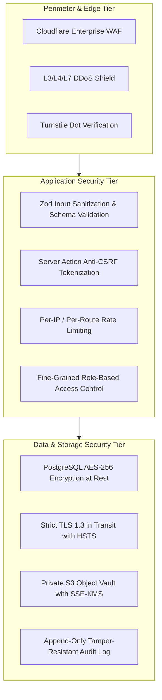
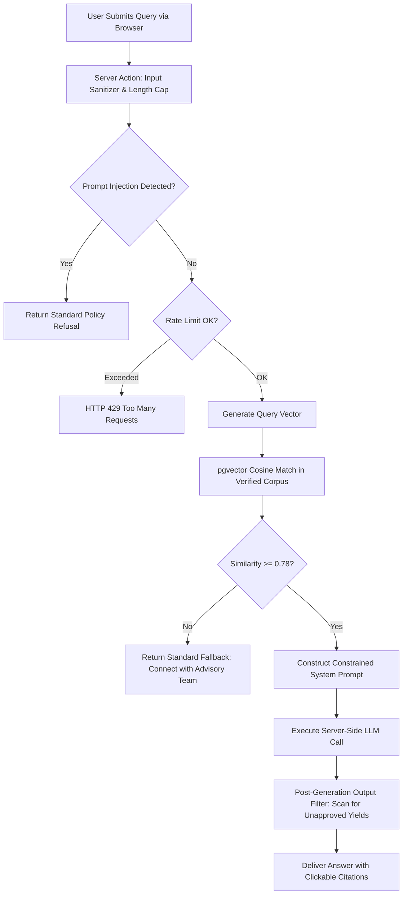

# Niventra Capital Advisory — Phase 2 Security & Compliance Architecture Plan

**Document Reference:** `docs/phase-2-security-plan.md`  
**Project Phase:** Phase 2 — Requirements Finalization & Architecture Planning  
**Date:** October 15, 2026  
**Author:** Senior Systems Security Engineer & Compliance Specialist  
**Workspace:** `d:\Projects\niventra website`  
**Classification:** Enterprise Information Security Architecture & Regulatory Compliance  

---

## 1. Security Philosophy & Threat Model

Operating in the Indian structured financial and corporate debenture sector requires adherence to strict regulatory standards, including the Digital Personal Data Protection (DPDP) Act, 2023, the Companies Act, 2013, and SEBI/RBI financial communications guidelines.



### Threat Landscape & Identified Attack Vectors:
1. **Public Brand Spoofing & Phishing:** Unauthorized entities copying contact numbers or logos to impersonate Niventra.
2. **Automated Form Spam & Lead Flooding:** Bots submitting malicious scripts or denial-of-service spam to intake forms.
3. **Session Hijacking & Privilege Escalation:** Unauthorized attempts to gain administrative or compliance officer privileges.
4. **Data Exfiltration of Investor PII:** Eavesdropping or querying unencrypted PAN, bank account, or contact records.
5. **Prompt Injection & AI Jailbreaking:** Crafting deceptive prompts to force the AI chatbot to endorse unapproved interest rates, fabricated regulatory licenses, or fraudulent financial advice.
6. **Payment Manipulation & Double-Spend:** Tampering with payment amounts, intercepting gateway webhooks, or forging debenture allocation events.

---

## 2. OWASP Top 10 Mitigation Strategy (Financial Sector Tailored)

| OWASP Vulnerability | Potential Threat to Niventra | Engineering Mitigation Standard |
| :--- | :--- | :--- |
| **A01: Broken Access Control** | An investor accessing another user's documents or an admin route. | • Server Actions enforce mandatory session validation and RBAC checks using session user ID from sealed cookies, never client-supplied IDs.<br>• Signed S3 URLs are bounded to 15 minutes and validated against user ownership. |
| **A02: Cryptographic Failures** | Interception of sensitive financial data in transit or storage. | • Mandatory TLS 1.3 with HSTS (`max-age=63072000; includeSubDomains; preload`).<br>• Passwords hashed with **Argon2id** (memory: 64MB, iterations: 3, parallelism: 1).<br>• Sensitive PII (PAN) encrypted at rest in PostgreSQL via column-level AES-GCM encryption. |
| **A03: Injection (SQL & Prompt)** | Malicious SQL in queries or prompt injection in the RAG chatbot. | • 100% parameterized queries via Prisma ORM (zero raw SQL string concatenation).<br>• Zod schemas sanitize all form inputs.<br>• LLM system prompt firewall with isolated context chunks; inputs parsed as pure data, never executable instructions. |
| **A04: Insecure Design** | Premature allocation of debentures upon simple payment receipt. | • Strict architectural separation: Payments update an escrow ledger, but debenture allocation is an independent legal milestone requiring compliance officer authorization. |
| **A05: Security Misconfiguration** | Missing security headers (as identified in the Phase 1 audit of the live site). | • Next.js middleware injects complete security headers on every response:<br>`Content-Security-Policy`, `Strict-Transport-Security`, `X-Frame-Options: DENY`, `X-Content-Type-Options: nosniff`, `Referrer-Policy: strict-origin-when-cross-origin`, `Permissions-Policy`. |
| **A06: Vulnerable Dependencies** | Outdated or compromised npm packages. | • Continuous CI vulnerability scanning via `npm audit` and Snyk.<br>• Automated Dependabot alerts and zero-tolerance policy for High/Critical CVEs. |
| **A07: Identification & Auth Failures** | Brute force password guessing, credential stuffing, or session fixation. | • Rate limiting on auth endpoints (max 5 attempts per 15 minutes per IP).<br>• Session cookies are `HttpOnly`, `Secure`, `SameSite=Strict`, with automatic invalidation on logout.<br>• Multi-Factor Authentication (TOTP / Magic Link). |
| **A08: Software & Data Integrity** | Webhook spoofing from payment providers or tampered PDFs. | • Cryptographic HMAC-SHA256 signature verification on all incoming webhooks using raw request bodies.<br>• Idempotency keys prevent replay attacks. |
| **A09: Logging & Monitoring Failures** | Undetected unauthorized access or silent compliance violations. | • Centralized structured logging to immutable `AuditLog` table capturing actor, action, timestamp, IP, and resource.<br>• Real-time alerting via Sentry and Cloudflare security notifications. |
| **A10: Server-Side Request Forgery** | Fetching arbitrary internal URLs via document processors or webhooks. | • Outbound HTTP requests restricted to strict, hardcoded allowlists (Resend, Cloudflare, Payment Gateway). Zero user-controllable URLs fetched. |

---

## 3. Data Protection & DPDP Act 2023 Compliance Framework

The Digital Personal Data Protection (DPDP) Act, 2023 mandates strict lawful processing, purpose specification, and data principal rights. The platform architecture incorporates compliance primitives directly into the core schema:

### 3.1 Lawful Basis & Notice (Section 5 & 6)
- **Notice on Collection:** Clear, concise notice presented before collecting personal data (Contact form, Investor application), detailing the exact purpose of collection, data categories, and grievance redressal officer coordinates.
- **Granular Consent Records:** User consent is captured with timestamp, IP address, and notice version, stored immutably in PostgreSQL.

### 3.2 Right to Correction & Erasure (Section 12)
- **Native Erasure Workflow:** The legacy `/delete-account/` page will be replaced by an authenticated deletion request engine.
- **Statutory Financial Retention Override:** In compliance with Section 128 of the Companies Act, 2013 (8-year retention for books of account) and Prevention of Money Laundering Act (PMLA) requirements:
  - Personal contact coordinates and marketing profiles are permanently purged or pseudonymized within 30 days of verified request.
  - Financial transaction ledgers, debenture allocation records, and statutory audit logs are retained in cold, encrypted storage with restricted compliance-only access until statutory retention periods expire.

### 3.3 Data Fiduciary Obligations & Security Safeguards (Section 8)
- **Zero Third-Party Data Leakage:** Elimination of the external unbranded Vercel link ([docs/decision-register.md#dec-05](file:///d:/Projects/niventra%20website/docs/decision-register.md)); all investor onboarding occurs directly on `niventracapitaladvisory.com` with first-party custody.
- **Cryptographic Watermarking:** Offering documents downloaded from the portal are dynamically watermarked with the recipient's verified email and timestamp, deterring unauthorized redistribution of private placement materials.

---

## 4. Grounded AI Chatbot Security & Anti-Hallucination Firewall



### Mandatory AI Guardrails:
1. **Air-Gapped API Credentials:** Model provider API keys reside strictly in server environment variables (`AI_SERVICE_KEY`), never bundled into client-side JS bundles.
2. **Context Window Whitelist:** Vector indexing is restricted exclusively to public website copy, verified FAQs, and authorized offering summaries. Internal discussions, draft files, or speculative return figures are blocked from vector ingestion.
3. **Deterministic Negative Prompting:** The system prompt explicitly instructs the LLM:
   > *"You are the Niventra Capital Advisory information assistant. Answer solely using the verified context provided below. If the context does not contain sufficient factual evidence to answer, state clearly: 'I do not have verified company information on that topic. Please contact our advisory team directly at info@niventracapitaladvisory.com or 1800-890-0818.' You must never invent, estimate, or extrapolate interest rates, returns, or regulatory approvals."*
4. **Output Safety Filter:** Before streaming responses to users, a regex-based post-processor scans for fabricated yields outside approved parameters, ensuring strict compliance with financial advertisement guidelines.

---

## 5. Financial Transaction Security & Anti-Fraud Controls (Phase 8 Conditional)

When Phase 8 financial workflows are initialized following regulatory certification, the following controls will govern all real-money movement:

1. **Idempotency Guarantee:** Every payment initiation request requires a unique client-generated UUID `Idempotency-Key` stored with a 24-hour expiration in PostgreSQL to eliminate duplicate billing during network timeouts.
2. **Webhook Cryptographic Handshake:** Payment gateway webhooks are rejected unless the raw payload matches the cryptographic HMAC-SHA256 signature using the provider's secret key.
3. **Tamper-Resistant Double-Entry Ledger:**
   - Every financial state transition (`INITIATED` -> `CONFIRMED` -> `ALLOCATED` or `REFUNDED`) creates an immutable audit record.
   - Database trigger prevents direct `UPDATE` or `DELETE` on the `payment_transactions` ledger.
4. **Two-Person Integrity (Dual Authorization):** Transitioning an investor's status from `CONFIRMED` payment to `ALLOCATED` debenture requires explicit sign-off by a designated Compliance Officer, maintaining separation between cash custody and security issuance.

---

## 6. Security Header Configuration (Next.js Middleware)

The following HTTP response headers will be enforced across all environments:

```typescript
// middleware.ts - Production Security Headers
export const securityHeaders = [
  {
    key: 'X-DNS-Prefetch-Control',
    value: 'on'
  },
  {
    key: 'Strict-Transport-Security',
    value: 'max-age=63072000; includeSubDomains; preload'
  },
  {
    key: 'X-Frame-Options',
    value: 'DENY'
  },
  {
    key: 'X-Content-Type-Options',
    value: 'nosniff'
  },
  {
    key: 'Referrer-Policy',
    value: 'strict-origin-when-cross-origin'
  },
  {
    key: 'Permissions-Policy',
    value: 'camera=(), microphone=(), geolocation=(), browsing-topics=()'
  },
  {
    key: 'Content-Security-Policy',
    value: `
      default-src 'self';
      script-src 'self' 'unsafe-inline' https://challenges.cloudflare.com;
      style-src 'self' 'unsafe-inline' https://fonts.googleapis.com;
      font-src 'self' https://fonts.gstatic.com data:;
      img-src 'self' data: blob: https://niventracapitaladvisory.com;
      connect-src 'self' https://challenges.cloudflare.com;
      frame-src https://challenges.cloudflare.com;
      object-src 'none';
      base-uri 'self';
      form-action 'self';
      frame-ancestors 'none';
      upgrade-insecure-requests;
    `.replace(/\s{2,}/g, ' ').trim()
  }
];
```

---

## 7. Incident Response, Monitoring & Auditability

1. **Real-Time Security Logging:** All authentication anomalies, rate-limit triggers, and administrative actions stream to Cloudflare Logpush and Sentry APM.
2. **Automated Alerts:** Instant PagerDuty/Slack alerts triggered on:
   - 5+ failed administrative logins within 5 minutes.
   - Any modification to product terms or pricing tranches.
   - Cloudflare WAF block spike (>100 blocks in 5 minutes).
3. **Vulnerability Disclosure Policy:** Formal security disclosure contact (`security@niventracapitaladvisory.com`) and `security.txt` RFC 9116 implementation.
