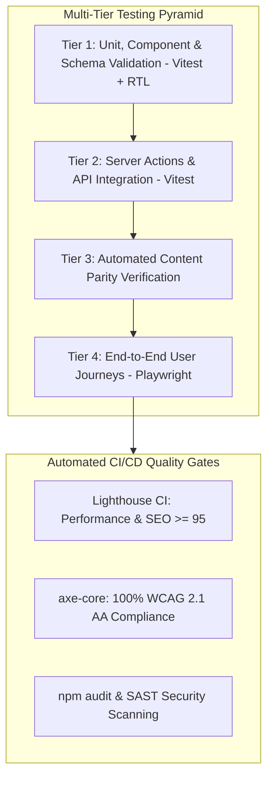
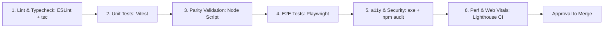

# Niventra Capital Advisory — Phase 2 Quality Assurance & Testing Strategy

**Document Reference:** `docs/phase-2-testing-strategy.md`  
**Project Phase:** Phase 2 — Requirements Finalization & Architecture Planning  
**Date:** October 15, 2026  
**Author:** QA Lead & Senior Technical Program Manager  
**Workspace:** `d:\Projects\niventra website`  
**Classification:** Enterprise Quality Assurance, Verification & Automated Testing  

---

## 1. Testing Philosophy & Quality Governance

In financial-services web platforms, software defects carry regulatory penalties, reputational damage, and financial risk. The testing strategy for the Niventra Capital Advisory platform enforces a zero-tolerance policy for content omissions, broken links, arithmetic discrepancies, and security vulnerabilities.



### Core Testing Mandates:
1. **Automated Content Parity Verification:** Programmatic validation verifying that 100% of the content elements listed in [docs/content-parity-checklist.md](file:///d:/Projects/niventra%20website/docs/content-parity-checklist.md) and [docs/content-inventory.csv](file:///d:/Projects/niventra%20website/docs/content-inventory.csv) are rendered without omission.
2. **Deterministic Financial Verification:** While public financial calculators are deferred to Phase 7, any future calculation engine must pass property-based testing matching CFO-certified spreadsheets down to the exact rupee.
3. **Rigorous Accessibility Certification:** Every public page must achieve 100% automated pass rates under `axe-core` for WCAG 2.1 Level AA standards.
4. **Cross-Browser & Device Matrix:** Continuous automated validation across Chromium, Firefox, WebKit (Safari), and mobile device viewports (iPhone 15, Pixel 8, iPad Pro).
5. **Enforcement of the 10 Visual Quality Gates:** Mandatory satisfaction of all 10 measurable gates codified in [docs/phase-2-visual-quality-gates.md](file:///d:/Projects/niventra%20website/docs/phase-2-visual-quality-gates.md) (Visual Polish, WCAG AA/AAA Contrast, Typography Scale, 60fps Micro-Motion, Multi-Device Responsive Matrix, 8 Component States, Asset Integrity, Content Parity, Link Health, and Web Vitals).

---

## 2. Multi-Tier Testing Pyramid

### Tier 1: Unit & Component Testing
- **Framework:** **Vitest** paired with **React Testing Library (RTL)** and `@testing-library/jest-dom`.
- **Target Coverage:** ≥ 90% code coverage across utility functions, formatting helpers, and UI component rendering.
- **Scope:**
  - Zod validation schemas (validating email formats, phone numbers, Indian PAN patterns, and text boundaries).
  - Indian Rupee number-to-words currency formatting functions.
  - UI Component states (buttons, modal dialogs, navigation dropdowns, card hover effects).
  - Date and tenure math utilities.

### Tier 2: Integration & Server Action Testing
- **Framework:** **Vitest** running against an isolated PostgreSQL test container or in-memory SQLite/Prisma instance.
- **Scope:**
  - Server Actions handling contact form submission, grievance intake, and profile updates.
  - Cloudflare Turnstile token verification mock validation.
  - RBAC permission enforcement: asserting that non-admins are rejected with HTTP 403 when invoking admin actions.
  - Document signed URL generator: asserting that URLs expire after 15 minutes and include correct authorization parameters.
  - SLA computation: verifying that grievance acknowledgment deadlines and escalation notifications are triggered correctly.

### Tier 3: Automated Content Parity Testing
- **Purpose:** Eliminate manual human error in verifying that no sections, disclaimers, or links from the live site were dropped during the rebuild.
- **Mechanism:** A custom Node.js verification script parses the built Next.js static pages and asserts:
  1. All 16 public canonical paths exist and return HTTP 200.
  2. Each page title and meta description matches the baseline cataloged in [docs/route-inventory.md](file:///d:/Projects/niventra%20website/docs/route-inventory.md).
  3. All 28 content sections from [docs/content-inventory.csv](file:///d:/Projects/niventra%20website/docs/content-inventory.csv) are present in the DOM with complete textual matching.
  4. The authentic `logo.png` is rendered in header and footer.
  5. Zero broken internal links (`href` destinations that return 404 or catch-all redirects).
  6. Zero unescaped mojibake artifacts (`₹`, `©`, `–`).

### Tier 4: End-to-End (E2E) User Journey Testing
- **Framework:** **Playwright** executing headless browser tests in CI/CD.
- **Critical Test Scenarios:**

```typescript
// tests/e2e/user-journeys.spec.ts
import { test, expect } from '@playwright/test';

test.describe('Public Website Parity & Navigation', () => {
  test('visitor can navigate all 16 public routes without authentication', async ({ page }) => {
    const routes = [
      '/', '/about/', '/debt-debenture/', '/real-estate/', '/due-diligence/',
      '/capital-providers/', '/investor-information/', '/contact/',
      '/risk-disclosure/', '/terms-conditions/', '/privacy-policy/',
      '/regulatory-disclosures/', '/grievance/', '/support-faq/', '/delete-account/'
    ];
    
    for (const route of routes) {
      const response = await page.goto(route);
      expect(response?.status()).toBe(200);
      await expect(page.locator('header img[alt*="Niventra"]')).toBeVisible();
      await expect(page.locator('footer')).toContainText('© 2026 Niventra Capital Advisory');
    }
  });

  test('contact form submits successfully and shows confirmation', async ({ page }) => {
    await page.goto('/contact/');
    await page.fill('input[name="fullName"]', 'Advisory Test Investor');
    await page.fill('input[name="email"]', 'test.investor@niventra-audit.com');
    await page.fill('input[name="phoneNumber"]', '9876543210');
    await page.selectOption('select[name="category"]', 'Capital Provider');
    await page.fill('textarea[name="message"]', 'Inquiry regarding debenture offerings.');
    
    // Simulate Turnstile success in test environment
    await page.click('button[type="submit"]');
    await expect(page.locator('.form-success-banner')).toBeVisible();
    await expect(page.locator('.form-success-banner')).toContainText('Thank you');
  });

  test('grievance redressal generates tracking ticket and records 48h SLA', async ({ page }) => {
    await page.goto('/grievance/');
    await page.fill('input[name="complainantName"]', 'Grievance Test User');
    await page.fill('input[name="email"]', 'grievance.test@domain.com');
    await page.fill('input[name="phoneNumber"]', '9876543210');
    await page.fill('textarea[name="details"]', 'Formal inquiry regarding communication timing.');
    
    await page.click('button[type="submit"]');
    await expect(page.locator('[data-testid="grievance-ticket"]')).toBeVisible();
    const ticketText = await page.locator('[data-testid="grievance-ticket"]').innerText();
    expect(ticketText).toMatch(/NIV-GRV-2026-\d{4}/);
  });
});
```

---

## 3. Accessibility (a11y) Testing Suite

- **Tooling:** `@axe-core/playwright` integrated directly into the CI test runner.
- **Target Standard:** **WCAG 2.1 Level AA** with zero violations.
- **Automated Test Assertion:**

```typescript
// tests/a11y/accessibility.spec.ts
import { test, expect } from '@playwright/test';
import AxeBuilder from '@axe-core/playwright';

test.describe('WCAG 2.1 Level AA Accessibility Audits', () => {
  const routes = ['/', '/about/', '/debt-debenture/', '/capital-providers/', '/contact/', '/grievance/'];
  
  for (const route of routes) {
    test(`route ${route} must have zero axe accessibility violations`, async ({ page }) => {
      await page.goto(route);
      const accessibilityScanResults = await new AxeBuilder({ page })
        .withTags(['wcag2a', 'wcag2aa', 'wcag21a', 'wcag21aa'])
        .analyze();
        
      expect(accessibilityScanResults.violations).toEqual([]);
    });
  }
});
```

- **Manual Verification Protocol:**
  1. Keyboard-only navigation across all interactive menus, modal dialogs, and forms (Tab, Shift+Tab, Enter, Space, Escape).
  2. Screen reader verification with NVDA (Windows) and VoiceOver (macOS).
  3. Color contrast verification across dark Navy (`#0B192C`) backgrounds with Warm Gold (`#D4AF37`) accents ensuring minimum 4.5:1 ratio.

---

## 4. Security, Penetration & Vulnerability Testing

1. **Static Application Security Testing (SAST):**
   - ESLint plugins (`eslint-plugin-security`) run on every commit to detect eval statements, insecure regexes, and unsafe buffer usage.
   - SonarQube / GitHub CodeQL scans checking for OWASP Top 10 vulnerabilities.
2. **Dynamic Application Security Testing (DAST):**
   - Automated OWASP ZAP baseline scan against staging deployment to verify absence of missing security headers, clickjacking vulnerabilities, and open CORS policies.
3. **Dependency Scanning:**
   - Pre-commit hook and CI action running `npm audit --audit-level=high`.
   - Zero builds allowed to deploy with known High or Critical CVEs.
4. **AI Chatbot Adversarial Testing:**
   - Automated suite of 50 adversarial prompts attempting prompt injection, role hijacking, and yield extraction.
   - Pass Criterion: 100% of injection attempts neutralized; zero output quoting unapproved yields or fabricated regulatory credentials.

---

## 5. Performance & Core Web Vitals Testing

- **Tooling:** **Lighthouse CI (`@lhci/cli`)** configured in GitHub Actions / GitLab CI.
- **Automated Assertions (`lighthouserc.json`):**

```json
{
  "ci": {
    "collect": {
      "numberOfRuns": 3,
      "startServerCommand": "npm run start"
    },
    "assert": {
      "assertions": {
        "categories:performance": ["error", {"minScore": 0.95}],
        "categories:accessibility": ["error", {"minScore": 1.0}],
        "categories:best-practices": ["error", {"minScore": 1.0}],
        "categories:seo": ["error", {"minScore": 1.0}],
        "first-contentful-paint": ["error", {"maxNumericValue": 1500}],
        "largest-contentful-paint": ["error", {"maxNumericValue": 2000}],
        "cumulative-layout-shift": ["error", {"maxNumericValue": 0.05}],
        "total-blocking-time": ["error", {"maxNumericValue": 200}]
      }
    }
  }
}
```

---

## 6. Continuous Integration (CI) Pipeline & Quality Gates

Every pull request must clear six automated gates before merging to `staging` or `main`:



| CI Gate | Command / Tool | Failure Threshold | Action on Failure |
| :--- | :--- | :--- | :--- |
| **Gate 1: Types & Lint** | `npm run lint && tsc --noEmit` | > 0 errors or warnings | Blocks build immediately |
| **Gate 2: Unit / Integration** | `npm run test:unit` | < 100% pass or < 90% coverage | PR merge blocked |
| **Gate 3: Content Parity** | `npm run test:parity` | Any missing section or broken link | PR merge blocked |
| **Gate 4: E2E Journeys** | `npm run test:e2e` | Any failed user journey | PR merge blocked |
| **Gate 5: a11y & Security** | `npm run test:a11y && npm audit` | Any WCAG AA violation or High CVE | PR merge blocked |
| **Gate 6: Performance** | `lhci autorun` | Score < 95 or LCP > 2.0s | Alert sent; blocks production merge |
