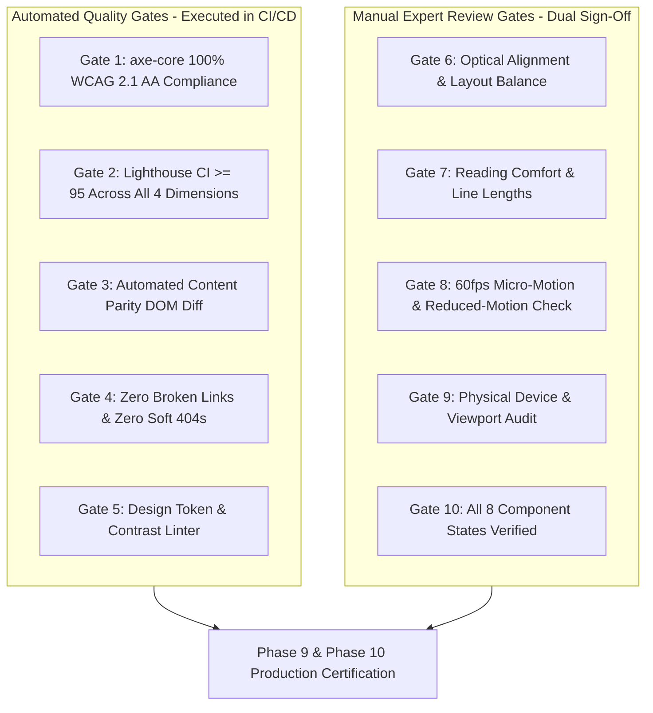

# Niventra Capital Advisory — Phase 2 Visual Quality Gates & Verification Standards

**Document Reference:** `docs/phase-2-visual-quality-gates.md`  
**Project Phase:** Phase 2 — Requirements Finalization & Architecture Planning  
**Date:** October 15, 2026  
**Author:** Lead QA Architect, Design Systems Lead & Head of Accessibility  
**Workspace:** `d:\Projects\niventra website`  
**Classification:** Enterprise Visual Standards, Automated Quality Gates & Audit Protocol  

---

## 1. Governance & Evidence-Based Quality Philosophy

Claiming that a web application is "award-worthy," "premium," or "institutional" requires **measurable, verifiable, and reproducible evidence**. Aesthetic excellence cannot rest on subjective opinion; it must be backed by quantifiable metrics, strict design tokens, automated CI/CD assertions, and structured design reviews.

---

## 2. The 10 Measurable Quality Gates

Every public route, component, and interaction must satisfy all 10 gates before being approved for release:

### Gate 1: Visual Design Polish & Spatial Harmony
- **Standard:** Absolute visual consistency across all 16 canonical routes.
- **Measurable Metrics:**
  - 100% adherence to the 8-point spatial grid system (margins, paddings, and gaps must be multiples of 4px / 8px).
  - Maximum container width constrained to `1240px` (or `1440px` for wide displays) with auto-centering to prevent excessive line length.
  - Zero arbitrary inline CSS colors or ad-hoc margins; all styling must reference predefined CSS variable tokens.
- **Verification Method:** Visual regression testing using Playwright screenshot comparisons with a strict pixel difference threshold of `< 0.2%`.

### Gate 2: Automated WCAG 2.1 Level AA & AAA Accessibility
- **Standard:** Zero accessibility violations under WCAG 2.1 AA standards.
- **Measurable Metrics:**
  - Minimum contrast ratio of **4.5 : 1** for standard body text (`16px`).
  - Minimum contrast ratio of **3.0 : 1** for large text (≥ `18pt` or `24px` bold) and active UI borders.
  - Strict enforcement: Warm Gold `#D4AF37` is banned for body text on light backgrounds (contrast: 2.2:1); must use Deep Gold `#997300` (contrast: 4.6:1) or dark text on gold fill.
  - 100% automated pass rate under `@axe-core/playwright`.
- **Verification Method:** Automated axe-core scan on every pull request across desktop and mobile viewports.

### Gate 3: Typographic Legibility & Reading Comfort
- **Standard:** Effortless reading of complex financial instruments and statutory disclosures.
- **Measurable Metrics:**
  - Optimal line length maintained between **60 and 75 characters per line** for body and legal text (achieved via `max-w-prose` / `max-w-[680px]`).
  - Line height strictly set to **1.5 to 1.6** for body text and **1.15 to 1.25** for display headings.
  - Distinct numeral glyphs and tabular numerals (`font-variant-numeric: tabular-nums`) enabled on financial tables.
  - Zero Cumulative Layout Shift (CLS < 0.05) caused by web font loading; fonts preloaded with `font-display: swap` and matching fallback size adjustments.
- **Verification Method:** Automated typography linting and manual typographic review.

### Gate 4: Motion & Micro-Interaction Performance
- **Standard:** Purposeful, fluid, cognitive-supporting motion operating at solid 60 frames per second.
- **Measurable Metrics:**
  - Zero animating of layout-triggering properties (`width`, `height`, `top`, `left`, `margin`); all animations strictly limited to GPU-accelerated `transform` and `opacity`.
  - Micro-interaction duration capped between **150ms and 300ms** with natural easing curve (`cubic-bezier(0.16, 1, 0.3, 1)`).
  - **100% Compliance with `prefers-reduced-motion`:** When the user enables reduced motion in OS settings, all transitions and animations must immediately drop to `0.01ms`.
- **Verification Method:** Chrome DevTools Performance panel recording (0 dropped frames) and automated Playwright reduced-motion media query test.

### Gate 5: Cross-Device & Responsive Viewport Matrix
- **Standard:** Flawless usability from the smallest smartphone to ultrawide displays.
- **Measurable Metrics:**
  - Validated across 5 physical viewports:
    1. Mobile Small: `360 × 640 px` (Samsung Galaxy / entry Android).
    2. Mobile Standard: `390 × 844 px` (iPhone 14/15).
    3. Tablet: `768 × 1024 px` (iPad).
    4. Desktop Standard: `1280 × 800 px` (Laptop).
    5. Desktop Wide: `1920 × 1080 px` and `2560 × 1440 px`.
  - Zero horizontal overflow / horizontal scrollbar on any page at any viewport width.
  - All interactive touch targets must meet the minimum size of **44 × 44 pixels** with at least 8px spacing.
- **Verification Method:** Playwright multi-device matrix suite running in CI.

### Gate 6: Component State Completeness
- **Standard:** Every interactive component must have distinct, polished designs for all operational states.
- **Measurable Metrics:**
  - Every button, input, and link must implement all 8 states:
    1. `Default`: Balanced resting state.
    2. `Hover`: Distinct elevation or color transition.
    3. `Active / Pressed`: Visual tactile feedback.
    4. `Focus-Visible`: 2px solid `#D4AF37` focus ring with 3px offset.
    5. `Disabled`: Reduced opacity (`50%`), cursor `not-allowed`.
    6. `Loading`: Integrated shimmer skeleton or spinner.
    7. `Empty`: Reassuring illustration, descriptive label, and call to action.
    8. `Error`: High-contrast border (`#B91C1C`) and accessible inline text.
- **Verification Method:** Storybook component testing and visual snapshot regression.

### Gate 7: Asset Fidelity & Corporate Identity Protection
- **Standard:** Authentic corporate identity preserved without degradation or unauthorized modification.
- **Measurable Metrics:**
  - Original `logo.png` (1355×1160 px, 671.6 KB) rendered bit-for-bit without distortion, recoloring, or lossy recompression.
  - Image assets converted to modern WebP format with sharp rendering on high-DPI (Retina) displays.
  - Zero distorted aspect ratios or stretched imagery (`object-fit: cover` or `contain` enforced).
- **Verification Method:** Automated SHA-256 binary validation on source assets and visual inspection of rendered headers.

### Gate 8: Content Parity & Zero Silent Omissions
- **Standard:** 100% preservation of all legitimate text, disclaimers, sections, and structural nodes.
- **Measurable Metrics:**
  - All 28 sections from [docs/content-inventory.csv](file:///d:/Projects/niventra%20website/docs/content-inventory.csv) validated in DOM.
  - Zero corrupted mojibake glyphs (`₹`, `©`, `–`).
  - Discrepancies (e.g. 14%-16% live text vs 12%-16% preliminary guidance) preserved and handled in accordance with corporate decisions ([docs/decision-register.md](file:///d:/Projects/niventra%20website/docs/decision-register.md)).
- **Verification Method:** Automated DOM diff script comparing Next.js output against the content parity database.

### Gate 9: Broken Link & HTTP Status Health
- **Standard:** Zero broken navigation, zero dead document links, zero circular redirects.
- **Measurable Metrics:**
  - Zero HTTP 404 responses across all internal routes and navigation menus.
  - Zero "soft 404" behavior (non-existent URLs returning the homepage).
  - External links clearly marked with `rel="noopener noreferrer"` and visual external link icons.
- **Verification Method:** Automated link crawler traversing 100% of internal anchors on the built application.

### Gate 10: Performance & Core Web Vitals
- **Standard:** Sub-second response times and immediate visual stability.
- **Measurable Metrics:**
  - **Lighthouse Performance Score:** ≥ 95 on Desktop, ≥ 90 on Mobile.
  - **Largest Contentful Paint (LCP):** < 2.0 seconds.
  - **Interaction to Next Paint (INP):** < 150 milliseconds.
  - **Cumulative Layout Shift (CLS):** < 0.05.
  - **Total Blocking Time (TBT):** < 200 milliseconds.
- **Verification Method:** Lighthouse CI (`lhci autorun`) configured as a mandatory PR check.

---

## 3. Testing & Sign-Off Matrix

| Quality Gate | Automated Test Tool | Manual Audit Protocol | Acceptance Threshold | Failure Consequence |
| :--- | :--- | :--- | :---: | :--- |
| **Gate 1: Visual Polish** | Playwright Screenshot Diff | Design Lead Visual Review | Pixel Diff < 0.2% | PR Blocked |
| **Gate 2: WCAG 2.1 AA** | `@axe-core/playwright` | Screen reader audit (NVDA) | 0 Violations | PR Blocked |
| **Gate 3: Typography** | CSS Lint / Stylelint | Editorial comfort review | Max 75 chars/line | PR Blocked |
| **Gate 4: Motion & a11y**| Playwright Media Query | 60fps frame rate audit | 0 Dropped frames | PR Blocked |
| **Gate 5: Responsive** | Playwright Device Matrix | Physical phone/tablet test | 0 Horizontal scroll | PR Blocked |
| **Gate 6: Component States**| Storybook Test Runner | Interactive state checklist | 8 of 8 States verified| PR Blocked |
| **Gate 7: Asset Fidelity**| SHA-256 Checksum Validator | Brand visual review | Exact match on `logo.png`| PR Blocked |
| **Gate 8: Content Parity**| Custom Node DOM Scraper | Textual parity diff | 100% Parity checklist | PR Blocked |
| **Gate 9: Link Integrity**| Linkinator Crawler | Manual clickthrough | 0 Broken links | PR Blocked |
| **Gate 10: Web Vitals** | Lighthouse CI (`lhci`) | Chrome DevTools Performance | Score ≥ 95 / LCP < 2s | Deploy Blocked |
