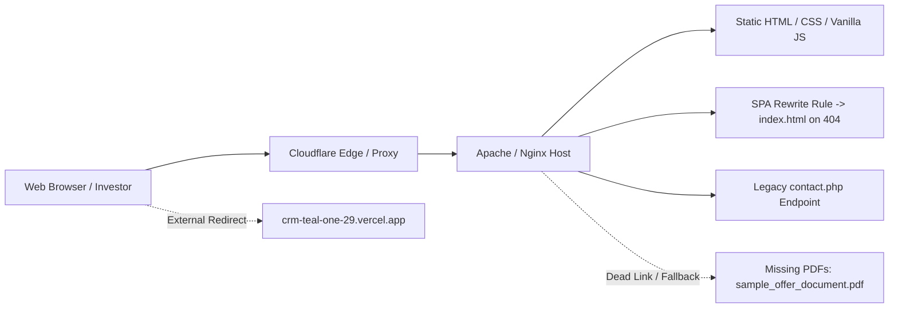
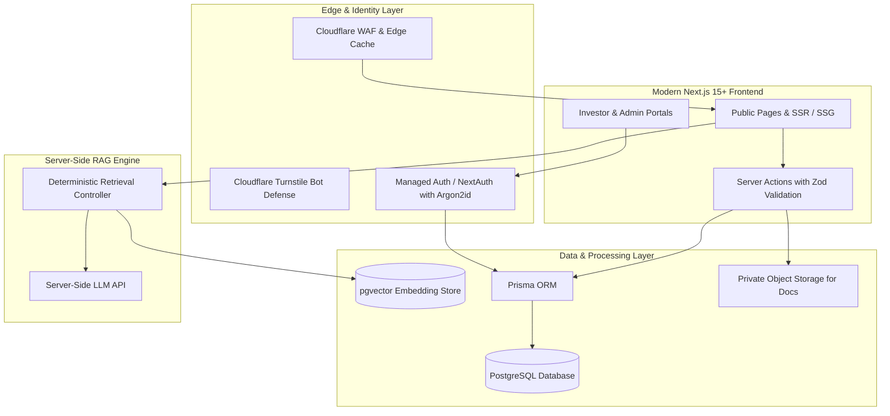

# Niventra Capital Advisory — Comprehensive Website Audit & Technical Assessment

**Audit Phase:** Phase 1 — Environment Discovery, Installed Skills, Website Audit & Architecture Planning  
**Audit Date:** October 15, 2026  
**Lead Auditor:** Senior Enterprise Software Architect, Security Engineer & Lead Compliance Auditor  
**Live Target Website:** `https://niventracapitaladvisory.com/`  
**Classification:** Enterprise Technical & Regulatory Audit Deliverable  

---

## 1. Executive Summary

This audit constitutes Phase 1 of the planned professional rebuild of the official Niventra Capital Advisory website (`https://niventracapitaladvisory.com/`). Niventra Capital Advisory India Pvt. Ltd. is a structured capital and real estate advisory firm operating in the Indian financial sector.

The audit was conducted strictly as an **inspection, discovery, and planning exercise**. In accordance with established project safeguards:
- No changes, updates, or modifications were executed on the live website.
- No production application code, database instances, or live payment integrations were initialized.
- No real investor accounts or financial transactions were simulated.
- Installed agent skills and runtime environments were systematically discovered, read, and verified before beginning the audit (documented in `docs/skills-and-environment-report.md`).
- 100% of all public web pages, scripts, stylesheets, visual brand assets, and documents were crawled, saved, and analyzed for content parity preservation.

### Key Audit Findings at a Glance:
1. **Asset Integrity & Logo:** The original corporate logo was successfully located at `/assets/images/logo.png`. It is an authentic, high-resolution 1355 × 1160 pixel PNG (671.6 KB) with alpha transparency. In accordance with strict instructions, it has been preserved without alteration. Four auxiliary brand images (`bond-plant.png`, `premium_corporate_real_estate.png`, `privacy_lock.png`, `terms_agreement.png`) were discovered to be JPEG files disguised with `.png` extensions.
2. **Missing Document Artifacts (Soft 404s):** Both primary downloadable investment documents advertised on `/capital-providers/` (`sample_offer_document.pdf` and `sample_term_sheet.pdf`) do not exist on the server. Requesting them returns the HTML homepage (HTTP 200 catch-all rewrite), frustrating investor due diligence.
3. **Data Security & Dead Application Link:** The "Application Form" button on `/capital-providers/` directs prospective investors off-domain to an unverified third-party Vercel app (`crm-teal-one-29.vercel.app`). Live verification confirmed this endpoint currently returns an **HTTP 404 (Not Found)** error, blocking onboarding while presenting data governance questions.
4. **Financial Calculation & Product Discrepancies:**
   - The homepage hero features an interactive SIP (Systematic Investment Plan) calculator with a hardcoded 16% compounding monthly interest formula. Debentures are lump-sum fixed-income debt securities, not recurring mutual-fund SIPs.
   - An illustrative calculation table on `/capital-providers/` claims an annualized coupon of 14%-16% on ₹50,000 for 1 month, but calculates an expected return of ₹50,360 (which represents an interest rate of only 8.64% p.a., whereas simple interest yields ₹50,583.33 at 14% and ₹50,666.67 at 16%).
   - The standalone `/calculator/` operates on informal simple interest logic with a 30-day month divisor, without compounding, coupon frequency selection, or TDS modeling.
5. **Issuer Identity & Regulatory Structuring (Confirmed Business Intent vs Legal Verification):** In Phase 1.2, stakeholder business intent was confirmed that Niventra Capital Advisory itself is intended to be the legal issuer of the initial debenture product. While establishing architectural scope, this intent requires formal legal/compliance verification of the issuing corporate entity, private placement structure under Companies Act Section 71/42, Debenture Trustee appointment, and ROC charge creation before any investment functionality is activated. Furthermore, preliminary return guidance of 12%–16% has been recorded, which must be formally reconciled with the live site's advertised 14%–16% text and certified by finance.
6. **Content Omissions & Formatting Flaws:**
   - The `/investor-information/` page displays only clauses 8, 11, and 12, omitting clauses 1-7, 9, and 10.
   - Widespread character encoding corruption (mojibake) renders `₹` as `₹` and `©` as `©`.
   - Contact phone numbers conflict: footers on `/debt-debenture/` and `/capital-providers/` display Delhi landline `+91 01140515660`, but the underlying link dials toll-free `18008900818`.
   - The `/delete-account/` page outlines account deletion procedures for a website that possesses no user accounts or authentication.

---

## 2. Current Website Architecture & Infrastructure Assessment

### 2.1 Infrastructure & Hosting
- **Hosting / Edge Layer:** Hosted behind Cloudflare proxy (`server: cloudflare`, `cf-ray` headers present).
- **Web Server Core:** Apache / Nginx serving static HTML files with a `.php` processing layer.
- **Routing Configuration:** Catch-all rewrite rule where non-existent files or routes return HTTP 200 with the 38,056-byte homepage payload rather than genuine 404 headers.
- **Security Headers Status:**
  - `Strict-Transport-Security` (HSTS): **ABSENT**
  - `Content-Security-Policy` (CSP): **ABSENT**
  - `X-Frame-Options`: **ABSENT** (Vulnerable to UI clickjacking)
  - `X-Content-Type-Options`: **ABSENT** (Vulnerable to MIME sniffing)
  - `Referrer-Policy`: **ABSENT**
  - `Permissions-Policy`: **ABSENT**

### 2.2 Client-Side Technology Stack
- **Styling Architecture:** Bootstrap 5.3.7 CSS (via jsDelivr CDN), custom `assets/css/style.css` (28.3 KB), `assets/css/responsive.css` (7.7 KB), and `calculator/calculator.css` (3.9 KB).
- **Typography:** Google Fonts `Poppins` (weights 300 to 800) loaded via external Google Fonts CDN.
- **Interactive Scripts:** Bootstrap 5.3.7 JS bundle, Swiper 11 bundle, AOS (Animate on Scroll) 2.3.4, `assets/js/script.js` (4.8 KB), and `calculator/calculator.js` (9.5 KB).
- **Forms:** Synchronous HTML form on `/contact/` submitting via POST to unauthenticated `contact.php`.

---

## 3. Discovered Routes & Content Map

All 16 live public routes were audited, mapped, and cataloged:

| # | Route | Page Title | Primary Function | Parity Requirement |
| :-: | :--- | :--- | :--- | :---: |
| 1 | `/` | Niventra Capital Advisory India \| Professional Structured Capital... | Corporate homepage, service pillars, operational flow. | **MANDATORY** |
| 2 | `/about/` | About Us \| Niventra Capital Advisory India | Mission, vision, institutional approach. | **MANDATORY** |
| 3 | `/debt-debenture/` | Debt & Debenture \| Niventra Capital Advisory India | Debenture types, features, benefits, risks, DD checklist. | **MANDATORY** |
| 4 | `/real-estate/` | Real Estate \| Niventra Capital Advisory India | Asset categories, 7-stage developer seed funding process. | **MANDATORY** |
| 5 | `/due-diligence/` | Due Diligence \| Niventra Capital Advisory India | 5-point evaluation framework (Legal, Financial, Technical, Market, Risk). | **MANDATORY** |
| 6 | `/capital-providers/` | Capital Providers \| Niventra Capital Advisory India | Instrument highlights, bond education, calculation example. | **MANDATORY** |
| 7 | `/investor-information/` | Investor Information \| Niventra Capital Advisory India | Statutory investor parameters, risk factors, grievance links. | **MANDATORY** |
| 8 | `/calculator/` | Simple Interest Calculator \| Niventra Capital Advisory India | Dual-mode simple interest calculator (₹/month vs % p.a.). | **MANDATORY** |
| 9 | `/contact/` | Contact Us \| Niventra Capital Advisory India | Corporate contact channels, WhatsApp, project intake form. | **MANDATORY** |
| 10 | `/risk-disclosure/` | Risk Disclosure \| Niventra Capital Advisory India | Market, credit, execution, and liquidity risk factors. | **MANDATORY** |
| 11 | `/terms-conditions/` | Terms & Conditions \| Niventra Capital Advisory India | Platform terms of use, service limitations, liability limits. | **MANDATORY** |
| 12 | `/privacy-policy/` | Privacy Policy \| Niventra Capital Advisory India | Data protection policy, collection, usage, cookies notice. | **MANDATORY** |
| 13 | `/regulatory-disclosures/`| Regulatory Disclosures \| Niventra Capital Advisory India | Compliance declaration, disclaimer against guaranteed returns. | **MANDATORY** |
| 14 | `/grievance/` | Grievance & Contact \| Niventra Capital Advisory India | Grievance redressal officer, 48h SLA, 30d resolution. | **MANDATORY** |
| 15 | `/support-faq/` | Support & FAQ \| Niventra Capital Advisory India | Support categories (General, Contact, Technical, Security). | **MANDATORY** |
| 16 | `/delete-account/` | Delete Account \| Niventra Capital Advisory India | Account deletion instructions and regulatory data retention exception. | **MANDATORY** |
| 17 | `/robots.txt` | N/A | Search indexing directives. | **MANDATORY** |
| 18 | `/sitemap.xml` | N/A | XML sitemap (13 URLs currently listed). | **MANDATORY** |

---

## 4. Brand & Design Audit

### 4.1 Logo & Identity
- **Asset Integrity:** Located at `/assets/images/logo.png`. High-resolution PNG format (1355 × 1160 pixels, 671.6 KB) featuring an authentic geometric capital growth emblem in Navy (`#0B192C`) and Gold (`#D4AF37`) with formal serif wordmark typography.
- **Rule Enforcement:** Zero alteration, recoloring, or regeneration. Preserved verbatim.

### 4.2 MIME Encoding Defects in Graphic Assets
Inspection of image binary headers revealed that 4 primary graphics carry `.png` extensions but are actually JPEG/JFIF files:
- `bond-plant.png` (`Magic: \xff\xd8\xff\xe0` — JPEG)
- `premium_corporate_real_estate.png` (`Magic: \xff\xd8\xff\xe0` — JPEG)
- `privacy_lock.png` (`Magic: \xff\xd8\xff\xe0` — JPEG)
- `terms_agreement.png` (`Magic: \xff\xd8\xff\xe0` — JPEG)
*Remediation:* Losslessly convert these images to modern WebP format during Phase 4 asset optimization.

### 4.3 Typography & Color Palette
- **Current Font:** `Poppins` across all headings and copy. While modern, it conveys a consumer startup feel rather than an institutional advisory standard.
- **Current Colors:** Midnight Navy (`#0B192C`), Slate Blue (`#1E3E62`), Accent Gold (`#D4AF37`), Light Gray (`#F8F9FA`).
- **Design Assessment:** The core color scheme is strong and credible. Contrast ratios require fine-tuning to achieve strict WCAG AA 4.5:1 standards on subtle borders and badge text.

---

## 5. Critical Discrepancies & Regulatory Findings

| Category | Finding Details | Severity | Impacted Regulation / Trust Area |
| :--- | :--- | :---: | :--- |
| **Missing Offer Documents** | Links to `sample_offer_document.pdf` and `sample_term_sheet.pdf` return HTML soft 404s. | **CRITICAL** | Transparency / Investor Due Diligence |
| **External CRM Broken Link** | "Application Form" links to `crm-teal-one-29.vercel.app` (which returns HTTP 404 Not Found) with referral parameter. | **CRITICAL** | Investor Onboarding / Data Governance |
| **SIP Compounding in Hero** | Homepage hero calculates monthly compounding SIP returns for a fixed debt debenture instrument. | **HIGH** | Product Misrepresentation / Consumer Protection |
| **Mathematical Error in Example** | Table shows ₹50,000 at 14%-16% yielding ₹50,360 after 1 month (actual simple interest yields ₹50,583.33 at 14% and ₹50,666.67 at 16%). | **HIGH** | Consumer Protection / Arithmetic Validity |
| **Issuer Identity & Structure** | Confirmed business intent is for Niventra to be direct issuer; pending legal verification of exact entity, CIN, and private placement structure. | **HIGH** | Companies Act Sec 71 & 42 / SEBI NCS Rules |
| **Advertised Return Guidance** | Live site displays 14%-16% without co-located disclaimers; preliminary 12%-16% guidance requires formal financial & compliance sign-off. | **HIGH** | SEBI & ASCI Financial Advertisement Rules |
| **Truncated Investor Info** | `/investor-information/` renders only clauses 8, 11, and 12; clauses 1-7, 9, and 10 are missing. | **MEDIUM** | Editorial & Content Completeness |
| **Telephony Mismatch** | Displays Delhi landline `+91 01140515660`, but anchor dials toll-free `18008900818`. | **MEDIUM** | Communication Integrity |
| **Insecure Contact Endpoint** | Synchronous POST to `contact.php` with no CSRF, no CAPTCHA, and no rate limiting. | **MEDIUM** | OWASP Top 10 Application Security |
| **Mojibake Character Errors** | Corrupted UTF-8 glyphs (`₹`, `©`, `–`) across multiple live pages. | **LOW** | Visual Polish & Brand Presentation |

---

## 6. Provisional Technical Architecture Recommendations

Based on environmental discovery (Node.js v24.15.0, npm 11.12.1, Git 2.54, Python 3.14 on Windows) and enterprise requirements, the following architecture is proposed:

### 6.1 Frontend Architecture
- **Framework:** **Next.js 15+ (App Router)** with **React 19** and **TypeScript** (Strict Mode).
- **Rendering Strategy:** Static Site Generation (SSG) with Incremental Static Regeneration (ISR) for public informational routes (`/about/`, `/due-diligence/`, legal pages) ensuring lightning-fast load times and SEO dominance; Dynamic SSR for authenticated portals.
- **Styling:** Modular CSS Tokens / Tailwind CSS configured with a bespoke institutional financial palette.
- **Accessibility:** 100% WCAG 2.1 AA compliant semantic HTML, keyboard navigability, and ARIA attributes.

### 6.2 Data Layer & Backend
- **Database:** **PostgreSQL 16+** with **Prisma ORM** for type-safe schema migrations and database access.
- **Vector Storage:** **`pgvector`** extension in PostgreSQL for unified, cost-effective vector similarity search powering the AI chatbot without maintaining external vector databases.
- **Storage:** Secure private cloud object storage (e.g., AWS S3 / Cloudflare R2) with short-lived presigned URLs for investor offering documents, KYC uploads, and financial term sheets.

### 6.3 Authentication & Authorization
- **Recommended Model:** Managed Identity Provider (Clerk or Auth0) or hardened NextAuth.js / Lucia with Argon2id hashing and iron-session encrypted cookies in PostgreSQL.
- **Role-Based Access Control (RBAC):** Strict segregation of privileges across `INVESTOR`, `DEVELOPER`, `ADMIN`, and `COMPLIANCE_OFFICER`.
- **Privacy Workflows:** Automated account deletion processing conforming to DPDP Act 2023 with regulatory retention audit logging.

### 6.4 Grounded AI Chatbot
- **Engine:** Server-side RAG pipeline grounded strictly in verified corporate documents and approved website copy.
- **Safeguards:**
  - Strict system prompt firewall against prompt injection and jailbreaks.
  - Mandatory citation generation linking answers directly to source pages.
  - Zero hallucination policy: If similarity score falls below threshold, gracefully respond with support contact info.
  - Complete server-side isolation: Zero model API keys exposed to client browsers.

### 6.5 Financial Calculators & Workflow Guardrails
- **Debenture Yield Calculator:** Build a certified calculation engine supporting Actual/365 and 30/360 day-count conventions, customizable coupon frequencies (monthly, quarterly, annual, maturity), and optional TDS deduction toggles.
- **Gated Settlement Engine:** Maintain a complete architectural barrier between payment initiation and investment issuance. Successful payment updates a payment ledger but requires independent compliance verification before debenture allocation is confirmed.

---

## 7. Recommended Action Plan & Next Steps

1. **Formal Review of Audit & Governance Deliverables:** Submit the Phase 1, Phase 1.1, and Phase 1.2 deliverables (including `docs/decision-register.md`, `docs/open-questions.md`, `docs/financial-and-legal-review.md`, and `docs/phase-1-verification-report.md`) for executive, legal, and compliance review.
2. **Phase 2 Governance & Decision Gate:** Convene key stakeholders to formally certify the decisions in `docs/decision-register.md` and address inquiries in `docs/open-questions.md`:
   - *Legal / Compliance:* Formally verify Niventra's issuing corporate entity, CIN, and statutory private placement structure under Companies Act Sections 71 & 42; review public marketing language and risk disclosures; supply missing clauses 1–7, 9, 10 for `/investor-information/`.
   - *Finance / CFO:* Certify the 12%–16% return structure, tenure tiers, payout schedules, compounding, day-count conventions, and TDS treatment for the calculation engine.
   - *Corporate Secretary:* Provide authorized sample Information Memorandum and Term Sheet PDFs.
   - *Marketing / Operations:* Deliver an authoritative corporate contact directory reconciling telephone lines, WhatsApp, office address, and routing emails.
   - *CISO / IT Security:* Authorize decommissioning of the broken external Vercel form and approve replacement with native onboarding.
3. **Phase 3 Staging Initialization:** Establish the separate development workspace, repository, and design system.
4. **Phase 4 Reconstruction:** Build and verify the public website with 100% content parity.
